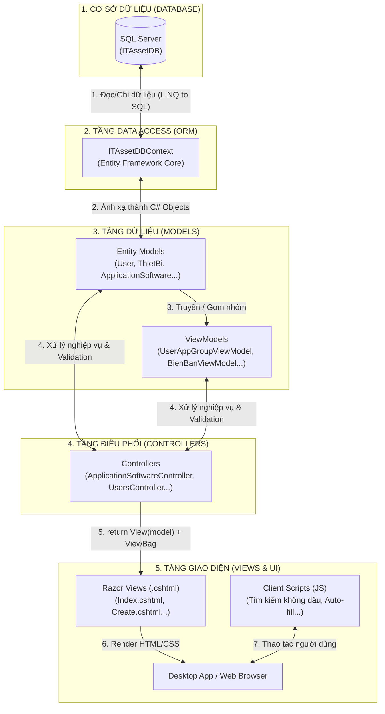

# CẨM NANG KIẾN THỨC KIẾN TRÚC MVC & LUỒNG DỮ LIỆU DỰ ÁN
**Dự án:** Hoàng Anh Group IT Device Manager Pro  
**Nền tảng:** ASP.NET Core MVC (.NET 10) | SQL Server | Entity Framework Core  

---

## MỤC LỤC
1. [Bức tranh tổng quan & Luồng đi của dữ liệu (Database $\to$ UI)](#1-bức-tranh-tổng-quan--luồng-đi-của-dữ-liệu-database--ui)
2. [Chi tiết 5 tầng cốt lõi trong hệ thống](#2-chi-tiết-5-tầng-cốt-lõi-trong-hệ-thống)
   - [Tầng 0: Khởi tạo & Cấu hình (Program.cs)](#tầng-0-khởi-tạo--cấu-hình-programcs)
   - [Tầng 1: Truy xuất CSDL (ITAssetDBContext - Data Access Layer)](#tầng-1-truy-xuất-csdl-itassetdbcontext---data-access-layer)
   - [Tầng 2: Dữ liệu thực thể & Hiển thị (Models & ViewModels)](#tầng-2-dữ-liệu-thực-thể--hiển-thị-models--viewmodels)
   - [Tầng 3: Bộ não điều phối nghiệp vụ (Controllers)](#tầng-3-bộ-não-điều-phối-nghiệp-vụ-controllers)
   - [Tầng 4: Giao diện hiển thị & Tương tác (Razor Views & JavaScript)](#tầng-4-giao-diện-hiển-thị--tương-tác-razor-views--javascript)
3. [Phân tích 2 tình huống thực tế (Case Study)](#3-phân-tích-2-tình-huống-thực-tế-case-study)
   - [Case Study 1: Luồng hiển thị danh sách gom nhóm](#case-study-1-luồng-hiển-thị-danh-sách-gom-nhóm-applicationsoftwareindex)
   - [Case Study 2: Luồng Modal tra cứu & Gán nhân sự tự động](#case-study-2-luồng-modal-tra-cứu--gán-nhân-sự-tự-động)
4. [Bộ câu hỏi & Trả lời nhanh khi Sếp / Phỏng vấn hỏi (Cheat Sheet)](#4-bộ-câu-hỏi--trả-lời-nhanh-khi-sếp--phỏng-vấn-hỏi-cheat-sheet)

---

## 1. BỨC TRANH TỔNG QUAN & LUỒNG ĐI CỦA DỮ LIỆU (DATABASE $\to$ UI)

Khi người dùng thao tác trên màn hình (như xem danh sách, thêm phần mềm, gán license), dữ liệu không nhảy thẳng lên màn hình mà đi qua một chu trình khép kín gồm 5 chặng:



---

## 2. CHI TIẾT 5 TẦNG CỐT LÕI TRONG HỆ THỐNG

### Tầng 0: Khởi tạo & Cấu hình (`Program.cs`)
- **Vai trò:** Cửa ngõ đầu tiên khi ứng dụng được bật lên.
- **Những gì được viết bên trong:**
  1. **Đăng ký dịch vụ (Dependency Injection - DI Container):**
     - Đăng ký `ITAssetDBContext` kết nối với SQL Server thông qua chuỗi kết nối.
     - Đăng ký MVC Controllers và Views (`AddControllersWithViews()`).
     - Đăng ký các dịch vụ chạy ngầm (như `HeartbeatService` kiểm tra kết nối định kỳ).
  2. **Cấu hình Pipeline xử lý HTTP:**
     - Thiết lập file tĩnh (`UseStaticFiles()`) phục vụ css, logo, javascript.
     - Thiết lập định tuyến (`MapControllerRoute`): Mặc định trỏ về `Home/Index` (`{controller=Home}/{action=Index}/{id?}`).
  3. **Khởi chạy cửa sổ ứng dụng:** Tích hợp bộ khung Desktop Hybrid (Photino) để hiển thị giao diện web trong một cửa sổ ứng dụng Windows độc lập (không cần mở Chrome/Edge thủ công).

---

### Tầng 1: Truy xuất CSDL (`ITAssetDBContext` - Data Access Layer)
- **File:** `ITAssetManagement/Models/ITAssetDBContext.cs`
- **Vai trò:** Chiếc cầu nối thông minh giữa mã nguồn C# và cơ sở dữ liệu SQL Server. Kế thừa từ class `DbContext` của thư viện **Entity Framework Core (EF Core)**.
- **Những gì được viết bên trong:**
  - Khai báo các bảng dữ liệu dưới dạng tập hợp C#:
    ```csharp
    public virtual DbSet<ThietBi> ThietBis { get; set; }
    public virtual DbSet<User> Users { get; set; }
    public virtual DbSet<License> Licenses { get; set; }
    public virtual DbSet<ApplicationSoftware> ApplicationSoftwares { get; set; }
    public virtual DbSet<LichSuDieuChuyen> LichSuDieuChuyens { get; set; }
    public virtual DbSet<LichSuBaoTri> LichSuBaoTris { get; set; }
    ```
  - **Bản chất hoạt động (ORM - Object Relational Mapping):** 
    - Thay vì phải viết câu lệnh SQL thủ công như `SELECT * FROM ApplicationSoftware WHERE Owner = 'Duy'`, ta chỉ cần viết C# LINQ: `_context.ApplicationSoftwares.Where(a => a.Owner == "Duy")`.
    - EF Core sẽ tự động dịch câu lệnh LINQ này thành SQL tối ưu để gửi xuống SQL Server, nhận kết quả và biến thành các đối tượng C#.
  - **Lưu dữ liệu:** Khi thêm hoặc cập nhật, gọi `_context.Add(entity)` và `await _context.SaveChangesAsync()`. EF Core sẽ tự động mở Transaction, chạy câu lệnh `INSERT` hoặc `UPDATE` an toàn xuống database.

---

### Tầng 2: Dữ liệu thực thể & Hiển thị (Models & ViewModels)
- **Nằm tại:** Thư mục `ITAssetManagement/Models/`
- **Gồm 2 loại Model riêng biệt:**

#### A. Entity Model (Mô hình thực thể CSDL)
- **Ví dụ:** `User.cs`, `ThietBi.cs`, `ApplicationSoftware.cs`, `License.cs`
- **Vai trò:** Đại diện 1-1 cho các dòng dữ liệu trong các bảng SQL Server.
- **Bên trong viết gì:** Chỉ thuần túy chứa các thuộc tính (Properties) tương ứng với các cột trong DB:
  ```csharp
  public partial class ApplicationSoftware
  {
      public int Id { get; set; }
      public int? UserId { get; set; }
      public string? Owner { get; set; }
      public string? PhongBan { get; set; }
      public string? May { get; set; }
      public string? UngDung { get; set; }
      public string? LoaiPhanMem { get; set; }
      public string? TrangThai { get; set; }
      public string? NgayCaiDat { get; set; }
  }
  ```

#### B. ViewModel (Mô hình phục vụ riêng cho hiển thị giao diện)
- **Ví dụ:** `UserAppGroupViewModel.cs`, `BienBanViewModel.cs`
- **Tại sao cần ViewModel mà không dùng thẳng Entity Model?**
  - Trong thực tế, bảng CSDL lưu dữ liệu phẳng (mỗi dòng là 1 phần mềm). Nhưng người dùng muốn xem dạng **Gom nhóm theo từng nhân sự**, mỗi nhân sự mở sổ xuống thấy 5-10 phần mềm họ đang dùng.
  - Entity Model không có cấu trúc gom nhóm này, nên ta tạo `UserAppGroupViewModel`:
    ```csharp
    public class UserAppGroupViewModel
    {
        public int? UserId { get; set; }
        public string Owner { get; set; } = "";
        public string PhongBan { get; set; } = "";
        public string May { get; set; } = "";
        public List<ApplicationSoftware> Apps { get; set; } = new(); // Danh sách phần mềm của riêng user này
    }
    ```

---

### Tầng 3: Bộ não điều phối nghiệp vụ (Controllers)
- **Nằm tại:** Thư mục `ITAssetManagement/Controllers/`
- **Ví dụ:** `ApplicationSoftwareController.cs`, `LicenseController.cs`, `UsersController.cs`
- **Vai trò:** Tiếp nhận mọi tương tác của người dùng, thực thi luật nghiệp vụ, lấy dữ liệu và chỉ định View nào sẽ được hiển thị.
- **Cấu trúc một Controller chuyên nghiệp:**
  1. **Dependency Injection (Tiêm phụ thuộc):** Nhận `ITAssetDBContext` vào thông qua hàm khởi tạo (Constructor) để sẵn sàng làm việc với DB.
  2. **Action Phương thức GET (Chuẩn bị dữ liệu hiển thị):**
     - Đọc dữ liệu từ DB thông qua DbContext.
     - Lọc dữ liệu theo tham số người dùng tìm kiếm (`search`, `loaiPhanMem`...).
     - Chuẩn bị các dữ liệu phụ trợ đưa vào `ViewBag` (ví dụ `ViewBag.Users`, `ViewBag.Devices`, `ViewBag.UserDevices`).
     - Trả về View bằng lệnh: `return View(data)`.
  3. **Action Phương thức POST (Xử lý khi người dùng ấn Lưu / Submit form):**
     - Đính kèm token bảo mật `[ValidateAntiForgeryToken]` chống tấn công giả mạo (CSRF).
     - Kiểm tra tính hợp lệ dữ liệu: `if (ModelState.IsValid)`.
     - Kiểm tra luật nghiệp vụ: Kiểm tra trùng Username, nếu chọn User thì tự động bù Họ tên, Phòng ban nếu bị bỏ trống.
     - Ghi dữ liệu xuống DB: `_context.Add(item); await _context.SaveChangesAsync();`.
     - Điều hướng trang và gửi thông báo: `TempData["SuccessMessage"] = "..."; return RedirectToAction(nameof(Index));`.

---

### Tầng 4: Giao diện hiển thị & Tương tác (Razor Views & JavaScript)
- **Nằm tại:** Thư mục `ITAssetManagement/Views/<TênController>/`
- **Ví dụ:** `Views/ApplicationSoftware/Index.cshtml`, `Views/ApplicationSoftware/Create.cshtml`, `Views/Shared/_Layout.cshtml`
- **Bên trong viết gì:**
  1. **Cú pháp Razor (`@`):**
     - Khai báo kiểu dữ liệu Model nhận từ Controller: `@model IEnumerable<UserAppGroupViewModel>` hoặc `@model ApplicationSoftware`.
     - Đọc dữ liệu từ `ViewBag`: `var users = ViewBag.Users as List<User>;`.
     - Chạy vòng lặp C# ngay trong HTML: `@foreach (var item in Model) { ... }`.
  2. **Thành phần HTML / Bootstrap 5 / Apple UI:**
     - Thiết kế theo chuẩn giao diện Apple Minimalist: Khung viền mỏng bo tròn (`rounded-3`), đổ bóng nhẹ (`shadow-sm`), huy hiệu trạng thái (Badges), thẻ Accordion sổ xuống.
  3. **Tương tác Client-side (JavaScript):**
     - **Modal tìm kiếm nhân sự (User Picker):** Không bắt người dùng cuộn chọn danh sách 200+ người, mà bật Modal tra cứu tức thì.
     - **Thuật toán tìm kiếm tiếng Việt không dấu (`removeVietnameseTones`):** Chuyển "Nguyễn Thị Xíu" thành "nguyen thi xiu" để người dùng gõ "xiu", "rnd" hay "duy" là tìm thấy ngay lập tức.
     - **Cơ chế Auto-fill:** Khi click chọn 1 nhân sự trong Modal, Javascript tự gán `UserId`, tự điền `Họ tên`, `Phòng ban` và tự gợi ý `Tên máy` vào các ô nhập liệu của Form.

---

## 3. PHÂN TÍCH 2 TÌNH HUỐNG THỰC TẾ (CASE STUDY)

### Case Study 1: Luồng hiển thị danh sách gom nhóm (`ApplicationSoftware/Index`)

```
[Người dùng click menu "Phần mềm cài đặt"]
                │
                ▼
1. Routing đưa request đến: ApplicationSoftwareController -> Index(search, loaiPhanMem)
                │
                ▼
2. Controller gọi EF Core truy vấn SQL Server:
   var query = _context.ApplicationSoftwares.AsQueryable();
   Lọc theo từ khóa tìm kiếm (Owner, Máy, Ứng dụng, Phòng ban...)
                │
                ▼
3. Controller gom nhóm dữ liệu theo User:
   query.GroupBy(a => new { a.Owner, a.PhongBan, a.May, a.UserId })
        .Select(g => new UserAppGroupViewModel { ... Apps = g.ToList() })
                │
                ▼
4. Controller tính toán các thẻ thống kê Apple Card (Tổng PM, Bản quyền, Đang dùng...)
   Gán vào ViewBag.TotalCount, ViewBag.LicensedCount...
                │
                ▼
5. Controller gọi: return View(grouped);
                │
                ▼
6. File Index.cshtml nhận `@model IEnumerable<UserAppGroupViewModel>`
   Chạy vòng lặp render từng Card nhân sự, bên trong có bảng chi tiết từng phần mềm.
```

---

### Case Study 2: Luồng Modal tra cứu & Gán nhân sự tự động

```
[Người dùng ấn nút "+ Thêm phần mềm mới" hoặc "Cài thêm PM"]
                │
                ▼
1. Controller chuẩn bị:
   - Danh sách Users: ViewBag.Users = _context.Users.OrderBy(...).ToList();
   - Từ điển máy tính: ViewBag.UserDevices = Map UserId -> Model máy tính;
   - Return View(app);
                │
                ▼
2. Màn hình Create.cshtml hiển thị:
   - Ô "Gán cho Nhân sự": Hiển thị text readonly kèm nút "🔍 Tìm nhân sự" và "✕ Xóa chọn".
   - Bên dưới nhúng Modal ẩn `userPickerModal`.
                │
                ▼
3. Người dùng bấm "🔍 Tìm nhân sự":
   - JavaScript mở Modal, tự động focus vào ô tìm kiếm.
   - Khi gõ "duy", JS duyệt qua các thẻ nhân sự, lọc bỏ dấu tiếng Việt, đếm số kết quả.
                │
                ▼
4. Người dùng bấm chọn thẻ nhân sự:
   - Hàm `selectUserFromModal(userId)` chạy:
     + Gán `userId` vào thẻ `<input type="hidden" asp-for="UserId">`
     + Điền tên nhân sự vào ô text hiển thị
     + Tự động điền Họ tên (`ownerInput`), Phòng ban (`deptInput`)
     + Tự động điền Model máy (`mayInput`) nếu nhân sự đó có máy trong hệ thống
     + Tự động đóng Modal
                │
                ▼
5. Người dùng bấm nút "Lưu thông tin":
   - Form gửi POST về `ApplicationSoftwareController.Create(ApplicationSoftware app)`.
   - Controller xác thực hợp lệ (`ModelState.IsValid`).
   - Gọi `_context.Add(app); await _context.SaveChangesAsync();`.
   - Dữ liệu ghi thành công vào SQL Server -> Chuyển về trang danh sách kèm thông báo xanh (Toast).
```

---

## 4. BỘ CÂU HỎI & TRẢ LỜI NHANH KHI SẾP / PHỎNG VẤN HỎI (CHEAT SHEET)

#### Q1: "Tại sao lại chia thành Controller, Model, View mà không viết chung cho nhanh?"
> **Trả lời:**  
> *"Dạ để đảm bảo nguyên lý **Độc lập trách nhiệm (Separation of Concerns)**:*
> - *Giao diện (**View**) chỉ lo việc hiển thị đẹp và tương tác với người dùng.*
> - *Bộ não (**Controller**) chỉ lo kiểm tra nghiệp vụ và ra quyết định.*
> - *Mô hình (**Model**) chỉ lo cấu trúc dữ liệu.*
> - *Khi cần đổi giao diện đẹp hơn (như vừa nâng cấp Modal tìm kiếm), em chỉ cần sửa View mà không làm vỡ logic nghiệp vụ hay cấu trúc Database. Dự án bảo trì và mở rộng sau này cực kỳ an toàn."*

#### Q2: "Dữ liệu từ bảng SQL lên đến Controller biến thành cái gì?"
> **Trả lời:**  
> *"Dạ thông qua **Entity Framework Core (EF Core)** và class **`ITAssetDBContext`**, mỗi dòng trong bảng SQL được tự động ánh xạ (map) thành một **C# Object (Entity Model)** có kiểu dữ liệu mạnh (Strongly-Typed) như `User`, `ThietBi`, `ApplicationSoftware`. Nhờ đó khi viết code, mình tận dụng được kiểm tra lỗi ngay lúc biên dịch (Compile-time), tránh hoàn toàn việc gõ sai tên cột gây lỗi runtime."*

#### Q3: "Tại sao trong dự án lại có cả Entity Model và ViewModel?"
> **Trả lời:**  
> *"Dạ:*
> - ***Entity Model** là bản thiết kế ánh xạ trực tiếp từ các bảng SQL Server (ví dụ bảng `ApplicationSoftware`).*
> - ***ViewModel** là mô hình dữ liệu tùy biến theo nhu cầu hiển thị của màn hình. Ví dụ như trang danh mục phần mềm cần gom nhóm: 1 người dùng đi kèm một danh sách 5-10 phần mềm của họ (`UserAppGroupViewModel`). CSDL lưu dạng phẳng từng dòng, nên cần ViewModel để gom nhóm phục vụ giao diện Accordion sổ xuống mượt mà."*

#### Q4: "Khi người dùng ấn 'Lưu thông tin', hệ thống xử lý như thế nào để đảm bảo không bị lỗi?"
> **Trả lời:**  
> *"Dạ qua 3 lớp phòng ngự:*
> 1. *Tại trình duyệt (Client-side): HTML5 và JavaScript kiểm tra các trường bắt buộc (`required`).*
> 2. *Tại Controller (Server-side): Đọc dữ liệu vào Model, kiểm tra `ModelState.IsValid`, kiểm tra tính toàn vẹn (như kiểm tra trùng Username, tự động bù dữ liệu phòng ban từ User nếu bị để trống).*
> 3. *Tại Database (Data Layer): Gọi `_context.SaveChangesAsync()` trong cơ chế Transaction an toàn. Nếu có bất kỳ lỗi nào, DB tự Rollback và Controller thông báo lỗi cụ thể cho người dùng chứ không làm sập ứng dụng."*

#### Q5: "Nếu dự án chạy như ứng dụng desktop, vậy có cần cài IIS hay server web phức tạp không?"
> **Trả lời:**  
> *"Dạ không cần ạ. Dự án sử dụng mô hình **Desktop Hybrid**: Nhân Web Server gọn nhẹ Kestrel được nhúng thẳng bên trong file `.exe`. Khi khởi động, ứng dụng tự mở một cửa sổ Native Windows (sử dụng thư viện Photino) kết nối trực tiếp đến database SQL Server trong mạng nội bộ, người dùng chỉ cần click đúp vào biểu tượng là chạy như một phần mềm desktop chuẩn."*

---
*Tài liệu được lập ngày 05/11/2026 bởi Đội ngũ Kỹ thuật CNTT Hoàng Anh Group.*
