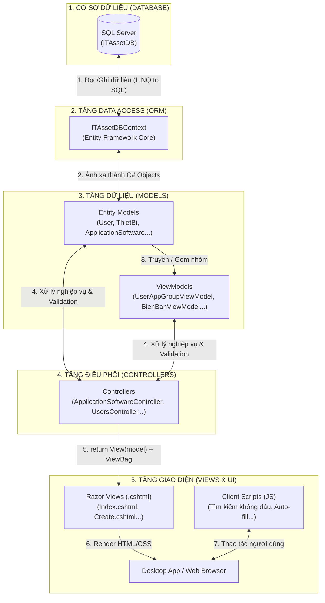
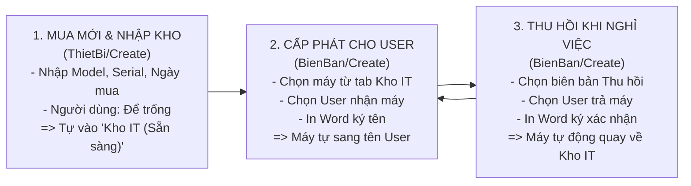

# CẨM NANG KIẾN THỨC KIẾN TRÚC MVC, LUỒNG DỮ LIỆU & BẢO MẬT HỆ THỐNG
**Dự án:** Hoàng Anh Group IT Device Manager Pro  
**Nền tảng:** ASP.NET Core MVC (.NET 10) | SQL Server | Entity Framework Core  

---

## MỤC LỤC
1. [Bức tranh tổng quan & Luồng đi của dữ liệu (Database $\to$ UI)](#1-bức-tranh-tổng-quan--luồng-đi-của-dữ-liệu-database--ui)
2. [Chi tiết 5 tầng cốt lõi trong hệ thống](#2-chi-tiết-5-tầng-cốt-lõi-trong-hệ-thống)
   - [Tầng 0: Khởi tạo & Cấu hình (Program.cs)](#tầng-0-khởi-tạo--cấu-hình-programcs)
   - [Tầng 1: Truy xuất CSDL (ITAssetDBContext - Data Access Layer)](#tầng-1-truy-xuất-csdl-itassetdbcontext---data-access-layer)
   - [Tầng 2: Dữ liệu thực thể & Hiển thị (Models & ViewModels)](#tầng-2-dữ-liệu-thực-thể--hiển-thị-models--viewmodels)
   - [Tầng 3: Bộ não điều phối nghiệp vụ (Controllers)](#tầng-3-bộ-não-điều-phối-nghiệp-vụ-controllers)
   - [Tầng 4: Giao diện hiển thị & Tương tác (Razor Views & JavaScript)](#tầng-4-giao-diện-hiển-thị--tương-tác-razor-views--javascript)
3. [Tại sao phải dùng Model thay vì thao tác trực tiếp với Database / Dữ liệu thô?](#3-tại-sao-phải-dùng-model-thay-vì-thao-tác-trực-tiếp-với-database--dữ-liệu-thô)
4. [Phân tích 3 tình huống thực tế (Case Study)](#4-phân-tích-3-tình-huống-thực-tế-case-study)
   - [Case Study 1: Luồng hiển thị danh sách gom nhóm](#case-study-1-luồng-hiển-thị-danh-sách-gom-nhóm-applicationsoftwareindex)
   - [Case Study 2: Luồng Modal tra cứu & Gán nhân sự tự động](#case-study-2-luồng-modal-tra-cứu--gán-nhân-sự-tự-động)
   - [Case Study 3: Quy trình Quản trị Vòng đời Thiết bị (Nhập kho -> Cấp phát -> Thu hồi)](#case-study-3-quy-trình-quản-trị-vòng-đời-thiết-bị-nhập-kho---cấp-phát---thu-hồi)
5. [Đánh giá bảo mật & Điểm chí mạng của hệ thống và mô hình MVC](#5-đánh-giá-bảo-mật--điểm-chí-mạng-của-hệ-thống-và-mô-hình-mvc)
   - [A. Hệ thống hiện tại có đủ bảo mật không?](#a-hệ-thống-hiện-tại-có-đủ-bảo-mật-không)
   - [B. 3 Điểm chí mạng của ứng dụng hiện tại](#b-3-điểm-chí-mạng-của-ứng-dụng-hiện-tại)
   - [C. 4 Điểm chí mạng kinh điển của mô hình kiến trúc MVC](#c-4-điểm-chí-mạng-kinh-điển-của-mô-hình-kiến-trúc-mvc)
6. [Bộ câu hỏi & Trả lời nhanh khi Sếp / Phỏng vấn hỏi (Cheat Sheet)](#6-bộ-câu-hỏi--trả-lời-nhanh-khi-sếp--phỏng-vấn-hỏi-cheat-sheet)
7. [Kịch bản thuyết trình báo cáo cho Sếp (Executive Presentation Guide)](#7-kịch-bản-thuyết-trình-báo-cáo-cho-sếp-executive-presentation-guide)
   - [A. Bảng đối chiếu Trước & Sau (Before vs After)](#a-bảng-đối-chiếu-trước--sau-before-vs-after)
   - [B. Kịch bản thuyết trình 5 phút (Nói từng phút chuẩn xác)](#b-kịch-bản-thuyết-trình-5-phút-chuẩn-chỉ-dành-cho-sếp)
   - [C. Các tình huống Sếp hỏi xoáy & Cách trả lời thông minh](#c-các-tình-huống-sếp-hỏi-xoáy--cách-trả-lời-thông-minh)

---

## 1. BỨC TRANH TỔNG QUAN & LUỒNG ĐI CỦA DỮ LIỆU (DATABASE $\to$ UI)

Khi người dùng thao tác trên màn hình (như xem danh sách, thêm phần mềm, gán license), dữ liệu không nhảy thẳng lên màn hình mà đi qua một chu trình khép kín gồm 5 chặng:



---

## 2. CHI TIẾT 5 TẦNG CỐT LÕI TRONG HỆ THỐNG

### Tầng 0: Khởi tạo & Cấu hình (`Program.cs`)
- **Vai trò:** Cửa ngõ đầu tiên khi ứng dụng được bật lên.
- **Những gì được viết bên trong:**
  1. **Đăng ký dịch vụ (Dependency Injection - DI Container):**
     - Đăng ký `ITAssetDBContext` kết nối với SQL Server thông qua chuỗi kết nối.
     - Đăng ký MVC Controllers và Views (`AddControllersWithViews()`).
     - Đăng ký các dịch vụ chạy ngầm (như `HeartbeatService` kiểm tra kết nối định kỳ).
  2. **Cấu hình Pipeline xử lý HTTP:**
     - Thiết lập file tĩnh (`UseStaticFiles()`) phục vụ css, logo, javascript.
     - Thiết lập định tuyến (`MapControllerRoute`): Mặc định trỏ về `Home/Index` (`{controller=Home}/{action=Index}/{id?}`).
  3. **Khởi chạy cửa sổ ứng dụng:** Tích hợp bộ khung Desktop Hybrid (Photino) để hiển thị giao diện web trong một cửa sổ ứng dụng Windows độc lập (không cần mở Chrome/Edge thủ công).

---

### Tầng 1: Truy xuất CSDL (`ITAssetDBContext` - Data Access Layer)
- **File:** `ITAssetManagement/Models/ITAssetDBContext.cs`
- **Vai trò:** Chiếc cầu nối thông minh giữa mã nguồn C# và cơ sở dữ liệu SQL Server. Kế thừa từ class `DbContext` của thư viện **Entity Framework Core (EF Core)**.
- **Những gì được viết bên trong:**
  - Khai báo các bảng dữ liệu dưới dạng tập hợp C#:
    ```csharp
    public virtual DbSet<ThietBi> ThietBis { get; set; }
    public virtual DbSet<User> Users { get; set; }
    public virtual DbSet<License> Licenses { get; set; }
    public virtual DbSet<ApplicationSoftware> ApplicationSoftwares { get; set; }
    public virtual DbSet<LichSuDieuChuyen> LichSuDieuChuyens { get; set; }
    public virtual DbSet<LichSuBaoTri> LichSuBaoTris { get; set; }
    ```
  - **Bản chất hoạt động (ORM - Object Relational Mapping):** 
    - Thay vì phải viết câu lệnh SQL thủ công như `SELECT * FROM ApplicationSoftware WHERE Owner = 'Duy'`, ta chỉ cần viết C# LINQ: `_context.ApplicationSoftwares.Where(a => a.Owner == "Duy")`.
    - EF Core sẽ tự động dịch câu lệnh LINQ này thành SQL tối ưu để gửi xuống SQL Server, nhận kết quả và biến thành các đối tượng C#.
  - **Lưu dữ liệu:** Khi thêm hoặc cập nhật, gọi `_context.Add(entity)` và `await _context.SaveChangesAsync()`. EF Core sẽ tự động mở Transaction, chạy câu lệnh `INSERT` hoặc `UPDATE` an toàn xuống database.

---

### Tầng 2: Dữ liệu thực thể & Hiển thị (Models & ViewModels)
- **Nằm tại:** Thư mục `ITAssetManagement/Models/`
- **Gồm 2 loại Model riêng biệt:**

#### A. Entity Model (Mô hình thực thể CSDL)
- **Ví dụ:** `User.cs`, `ThietBi.cs`, `ApplicationSoftware.cs`, `License.cs`
- **Vai trò:** Đại diện 1-1 cho các dòng dữ liệu trong các bảng SQL Server.
- **Bên trong viết gì:** Chứa các thuộc tính (Properties) tương ứng với các cột trong DB:
  ```csharp
  public partial class ApplicationSoftware
  {
      public int Id { get; set; }
      public int? UserId { get; set; }
      public string? Owner { get; set; }
      public string? PhongBan { get; set; }
      public string? May { get; set; }
      public string? UngDung { get; set; }
      public string? LoaiPhanMem { get; set; }
      public string? TrangThai { get; set; }
      public string? NgayCaiDat { get; set; }
  }
  ```

#### B. ViewModel (Mô hình phục vụ riêng cho hiển thị giao diện)
- **Ví dụ:** `UserAppGroupViewModel.cs`, `BienBanViewModel.cs`
- **Tại sao cần ViewModel mà không dùng thẳng Entity Model?**
  - Trong thực tế, bảng CSDL lưu dữ liệu phẳng (mỗi dòng là 1 phần mềm). Nhưng người dùng muốn xem dạng **Gom nhóm theo từng nhân sự**, mỗi nhân sự mở sổ xuống thấy 5-10 phần mềm họ đang dùng.
  - Entity Model không có cấu trúc gom nhóm này, nên ta tạo `UserAppGroupViewModel`:
    ```csharp
    public class UserAppGroupViewModel
    {
        public int? UserId { get; set; }
        public string Owner { get; set; } = "";
        public string PhongBan { get; set; } = "";
        public string May { get; set; } = "";
        public List<ApplicationSoftware> Apps { get; set; } = new(); // Danh sách phần mềm của riêng user này
    }
    ```

---

### Tầng 3: Bộ não điều phối nghiệp vụ (Controllers)
- **Nằm tại:** Thư mục `ITAssetManagement/Controllers/`
- **Ví dụ:** `ApplicationSoftwareController.cs`, `LicenseController.cs`, `UsersController.cs`
- **Vai trò:** Tiếp nhận mọi tương tác của người dùng, thực thi luật nghiệp vụ, lấy dữ liệu và chỉ định View nào sẽ được hiển thị.
- **Cấu trúc một Controller chuyên nghiệp:**
  1. **Dependency Injection (Tiêm phụ thuộc):** Nhận `ITAssetDBContext` vào thông qua hàm khởi tạo (Constructor) để sẵn sàng làm việc với DB.
  2. **Action Phương thức GET (Chuẩn bị dữ liệu hiển thị):**
     - Đọc dữ liệu từ DB thông qua DbContext.
     - Lọc dữ liệu theo tham số người dùng tìm kiếm (`search`, `loaiPhanMem`...).
     - Chuẩn bị các dữ liệu phụ trợ đưa vào `ViewBag` (ví dụ `ViewBag.Users`, `ViewBag.Devices`, `ViewBag.UserDevices`).
     - Trả về View bằng lệnh: `return View(data)`.
  3. **Action Phương thức POST (Xử lý khi người dùng ấn Lưu / Submit form):**
     - Đính kèm token bảo mật `[ValidateAntiForgeryToken]` chống tấn công giả mạo (CSRF).
     - Kiểm tra tính hợp lệ dữ liệu: `if (ModelState.IsValid)`.
     - Kiểm tra luật nghiệp vụ: Kiểm tra trùng Username, nếu chọn User thì tự động bù Họ tên, Phòng ban nếu bị bỏ trống.
     - Ghi dữ liệu xuống DB: `_context.Add(item); await _context.SaveChangesAsync();`.
     - Điều hướng trang và gửi thông báo: `TempData["SuccessMessage"] = "..."; return RedirectToAction(nameof(Index));`.

---

### Tầng 4: Giao diện hiển thị & Tương tác (Razor Views & JavaScript)
- **Nằm tại:** Thư mục `ITAssetManagement/Views/<TênController>/`
- **Ví dụ:** `Views/ApplicationSoftware/Index.cshtml`, `Views/ApplicationSoftware/Create.cshtml`, `Views/Shared/_Layout.cshtml`
- **Bên trong viết gì:**
  1. **Cú pháp Razor (`@`):**
     - Khai báo nhận Model từ Controller: `@model IEnumerable<UserAppGroupViewModel>` hoặc `@model ApplicationSoftware`.
     - Đọc dữ liệu từ `ViewBag`: `var users = ViewBag.Users as List<User>;`.
     - Chạy vòng lặp C# ngay trong HTML: `@foreach (var item in Model) { ... }`.
  2. **Thành phần HTML / Bootstrap 5 / Apple UI:**
     - Khung viền mỏng bo tròn (`rounded-3`), đổ bóng nhẹ (`shadow-sm`), huy hiệu trạng thái (Badges), thẻ Accordion sổ xuống.
  3. **Tương tác Client-side (JavaScript):**
     - **Modal tìm kiếm nhân sự (User Picker):** Không bắt người dùng cuộn chọn danh sách 200+ người, mà bật Modal tra cứu tức thì.
     - **Thuật toán tìm kiếm tiếng Việt không dấu (`removeVietnameseTones`):** Chuyển "Nguyễn Thị Xíu" thành "nguyen thi xiu" để người dùng gõ "xiu", "rnd" hay "duy" là tìm thấy ngay lập tức.
     - **Cơ chế Auto-fill:** Khi click chọn 1 nhân sự trong Modal, Javascript tự gán `UserId`, tự điền `Họ tên`, `Phòng ban` và tự gợi ý `Tên máy` vào các ô nhập liệu của Form.

---

## 3. TẠI SAO PHẢI DÙNG MODEL THAY VÌ THAO TÁC TRỰC TIẾP VỚI DATABASE / DỮ LIỆU THÔ?

Việc đóng gói dữ liệu thành các Object (Model) và thực hiện tính toán, xử lý logic trên Model mang lại những lợi thế khổng lồ so với việc thao tác trực tiếp bằng các câu truy vấn SQL thuần hoặc dữ liệu mảng/chuỗi thô (`DataTable`, `Dictionary<string, object>`):

### 1. Tránh sai vặt nhờ tính năng gợi ý code (IntelliSense & Compile-time Safety)
* **Nếu thao tác trực tiếp với dữ liệu thô:** Dữ liệu trả về thường ở dạng bảng (`DataTable`). Để lấy tên nhân sự, bạn phải viết: `thietBiRow["TenNhanVien"]`. Chỉ cần bạn gõ nhầm chữ "v" thành "V" (`TenNhanVien` thành `TenNhanvien`), code vẫn cho phép biên dịch chạy, nhưng đến lúc người dùng bấm nút thì ứng dụng sẽ **báo lỗi sập web (Runtime Crash)**.
* **Khi dùng Model:** Vì `User` hay `ThietBi` đã được định nghĩa thành một khuôn mẫu rõ ràng (Class), khi bạn gõ `thietBi.`, Visual Studio / VS Code sẽ tự động xổ ra danh sách các thuộc tính như `TenNhanVien`, `MaThietBi` để bạn chọn. Trình biên dịch C# sẽ **báo lỗi gạch chân màu đỏ ngay lúc bạn đang gõ** nếu sai chính tả, không đợi đến lúc chạy thử mới phát hiện lỗi.

### 2. Đặt luật lệ và kiểm tra tính hợp lệ (Validation) ở một nơi duy nhất
Giả sử bạn có quy định: *"Mã thiết bị IT phải dài tối đa 20 ký tự và không được để trống"*.
* **Nếu thao tác trực tiếp trên giao diện hoặc Database:** Bạn sẽ phải viết các đoạn mã IF/ELSE kiểm tra rườm rà ở khắp mọi nơi (từ màn hình Thêm mới, đến Chỉnh sửa, đến Import Excel).
* **Với Model:** Bạn chỉ cần gắn "thẻ" (Data Annotations) trực tiếp vào file C# một lần duy nhất:
  ```csharp
  [Required(ErrorMessage = "Mã thiết bị không được để trống")]
  [MaxLength(20, ErrorMessage = "Tối đa 20 ký tự")]
  public string MaThietBi { get; set; } = null!;
  ```
  Từ đó, bất cứ tính năng nào (thêm, sửa) gọi đến Model này, hệ thống sẽ tự động kiểm tra qua câu lệnh `ModelState.IsValid`. Nếu vi phạm, nó tự động hiển thị thông báo lỗi màu đỏ lên màn hình giao diện (View) mà bạn không cần phải code thêm bất kỳ dòng kiểm tra thủ công nào.

### 3. Tái sử dụng logic tính toán dễ dàng (Computed / Calculated Properties)
Giả sử thiết bị có ngày đưa vào sử dụng `NgayMua` và bạn cần hiển thị `ThoiGianBaoHanhConLai`.
* Thay vì mỗi lần hiển thị lên View bạn lại phải viết code tính toán (hoặc viết hàm phức tạp Stored Procedure dưới SQL Server), bạn chỉ cần định nghĩa một thuộc tính tự tính toán ngay trong Model `ThietBi`:
  ```csharp
  public int ThoiGianBaoHanhConLai 
  { 
      get { return 36 - (DateTime.Now.Year - NgayMua.Year) * 12; } // Giả sử bảo hành 36 tháng
  }
  ```
  Lúc này, sang bên View (HTML), bạn chỉ việc gọi `@thietBi.ThoiGianBaoHanhConLai` là xong. Logic được bảo vệ, giấu kín và xử lý gọn gàng bên trong C#.

### 4. Bảo mật và linh hoạt (Không phơi bày toàn bộ Database ra ngoài)
Không phải cột nào dưới SQL Server cũng được phép đưa lên giao diện. Ví dụ bảng `User` có cột `PasswordHash`, `TokenKey` hoặc thông tin lương bổng nội bộ.
* Nếu thao tác trực tiếp bằng cách móc thẳng Database trả về cho giao diện, nguy cơ lộ dữ liệu nhạy cảm là rất cao.
* Khi dùng Model, bạn có quyền tạo ra các Model riêng cho giao diện (gọi là **ViewModel**), nó chỉ chứa đúng `HoTen`, `PhongBan` và `DanhSachPhanMem` để gửi ra màn hình, loại bỏ hoàn toàn các cột nhạy cảm trước khi dữ liệu rời khỏi server.

> **Hình tượng so sánh:**  
> Thao tác trực tiếp với Database/dữ liệu thô giống như bạn **lái xe số sàn và tự chỉnh xăng gió thủ công** — rất dễ sặc xăng, chết máy và hỏng hóc nếu non tay. Còn sử dụng Model là bạn đang **lái xe số tự động**: an toàn, được kiểm soát lỗi chặt chẽ, dễ bảo trì và code cực kỳ sạch sẽ.

---

## 4. PHÂN TÍCH 2 TÌNH HUỐNG THỰC TẾ (CASE STUDY)

### Case Study 1: Luồng hiển thị danh sách gom nhóm (`ApplicationSoftware/Index`)

```
[Người dùng click menu "Phần mềm cài đặt"]
                │
                ▼
1. Routing đưa request đến: ApplicationSoftwareController -> Index(search, loaiPhanMem)
                │
                ▼
2. Controller gọi EF Core truy vấn SQL Server:
   var query = _context.ApplicationSoftwares.AsQueryable();
   Lọc theo từ khóa tìm kiếm (Owner, Máy, Ứng dụng, Phòng ban...)
                │
                ▼
3. Controller gom nhóm dữ liệu theo User:
   query.GroupBy(a => new { a.Owner, a.PhongBan, a.May, a.UserId })
        .Select(g => new UserAppGroupViewModel { ... Apps = g.ToList() })
                │
                ▼
4. Controller tính toán các thẻ thống kê Apple Card (Tổng PM, Bản quyền, Đang dùng...)
   Gán vào ViewBag.TotalCount, ViewBag.LicensedCount...
                │
                ▼
5. Controller gọi: return View(grouped);
                │
                ▼
6. File Index.cshtml nhận `@model IEnumerable<UserAppGroupViewModel>`
   Chạy vòng lặp render từng Card nhân sự, bên trong có bảng chi tiết từng phần mềm.
```

---

### Case Study 2: Luồng Modal tra cứu & Gán nhân sự tự động

```
[Người dùng ấn nút "+ Thêm phần mềm mới" hoặc "Cài thêm PM"]
                │
                ▼
1. Controller chuẩn bị:
   - Danh sách Users: ViewBag.Users = _context.Users.OrderBy(...).ToList();
   - Từ điển máy tính: ViewBag.UserDevices = Map UserId -> Model máy tính;
   - Return View(app);
                │
                ▼
2. Màn hình Create.cshtml hiển thị:
   - Ô "Gán cho Nhân sự": Hiển thị text readonly kèm nút "🔍 Tìm nhân sự" và "✕ Xóa chọn".
   - Bên dưới nhúng Modal ẩn `userPickerModal`.
                │
                ▼
3. Người dùng bấm "🔍 Tìm nhân sự":
   - JavaScript mở Modal, tự động focus vào ô tìm kiếm.
   - Khi gõ "duy", JS duyệt qua các thẻ nhân sự, lọc bỏ dấu tiếng Việt, đếm số kết quả.
                │
                ▼
4. Người dùng bấm chọn thẻ nhân sự:
   - Hàm `selectUserFromModal(userId)` chạy:
     + Gán `userId` vào thẻ `<input type="hidden" asp-for="UserId">`
     + Điền tên nhân sự vào ô text hiển thị
     + Tự động điền Họ tên (`ownerInput`), Phòng ban (`deptInput`)
     + Tự động điền Model máy (`mayInput`) nếu nhân sự đó có máy trong hệ thống
     + Tự động đóng Modal
                │
                ▼
5. Người dùng bấm nút "Lưu thông tin":
   - Form gửi POST về `ApplicationSoftwareController.Create(ApplicationSoftware app)`.
   - Controller xác thực hợp lệ (`ModelState.IsValid`).
   - Gọi `_context.Add(app); await _context.SaveChangesAsync();`.
   - Dữ liệu ghi thành công vào SQL Server -> Chuyển về trang danh sách kèm thông báo xanh (Toast).
```

---

### Case Study 3: Quy trình Quản trị Vòng đời Thiết bị (Nhập kho -> Cấp phát -> Thu hồi)

Một quy trình quản trị tài sản IT chuẩn doanh nghiệp diễn ra theo đúng chu kỳ 3 bước khép kín:



#### Bước 1: Mua mới & Nhập kho IT (`/ThietBi/Create`)
* **Hành động:** Khi máy mới về công ty kèm hóa đơn, IT vào **Thêm thiết bị mới**, nhập Model, Serial, Cấu hình, Thời gian đầu tư (tháng/năm mua) và HSD ban đầu.
* **Logic tự động:** Nếu người sử dụng để trống, hệ thống tự động:
  - Gán `Owner = "Kho IT"` và `PhongBan = "IT"`.
  - Hiển thị huy hiệu xanh lá cây: `[📦 Kho IT (Sẵn sàng)]` trên trang danh sách.
  - Tự động ghi nhật ký vào bảng `LichSuDieuChuyen`: *"Ghi nhận tài sản mới vào Kho IT từ Nhà cung cấp"*.

#### Bước 2: Bàn giao cấp phát cho nhân sự (`/BienBan/Create`)
* **Hành động:** Khi nhân sự mới nhận việc hoặc nhân viên cũ đổi máy, IT vào **Biên bản Bàn giao $\to$ Cấp phát**.
* **Logic tự động:**
  - Bấm chọn thiết bị từ tab **"Kho IT"** $\to$ Toàn bộ thông số máy và thời gian đầu tư tự động điền vào biên bản.
  - Bấm chọn User nhận $\to$ Tự động điền Họ tên, Chức vụ, Phòng ban, Email M365, Domain.
  - In file Word (.docx) để 2 bên ký tên lưu hồ sơ.
  - Bấm **"Lưu lịch sử điều chuyển"**: Hệ thống tự động chuyển máy từ *"Kho IT"* sang tên nhân viên đó.

#### Bước 3: Thu hồi khi nhân viên nghỉ việc / đổi máy (`/BienBan/Create`)
* **Hành động:** Khi nhân sự nghỉ việc, IT chọn loại biên bản **"Thu hồi"**.
* **Logic tự động:**
  - Chọn nhân sự trả máy $\to$ Tự động kéo thông tin thiết bị đang giữ, tài khoản Email M365 và các phân hệ ERP cần khóa.
  - Bấm **"Lưu lịch sử điều chuyển"**: Thiết bị lập tức được thu hồi và tự động quay trở về trạng thái **"Kho IT (Sẵn sàng)"** để chờ cấp phát cho người tiếp theo mà không cần phải vào sửa thiết bị thủ công.

---

## 5. ĐÁNH GIÁ BẢO MẬT & ĐIỂM CHÍ MẠNG CỦA HỆ THỐNG VÀ MÔ HÌNH MVC

### A. Hệ thống hiện tại có đủ bảo mật không?

#### 1. Những điểm ĐÃ BẢO MẬT TỐT (Strong Points)
1. **Chống tấn công SQL Injection:**
   - Ứng dụng dùng **Entity Framework Core (LINQ)** thay vì cộng chuỗi câu lệnh SQL thô. EF Core tự động tham số hóa (Parameterized Query) mọi biến truyền vào, triệt tiêu 100% nguy cơ SQL Injection.
2. **Chống tấn công giả mạo yêu cầu (CSRF):**
   - Mọi form gửi dữ liệu lên (POST) đều có thẻ `[ValidateAntiForgeryToken]` và token ẩn được mã hóa. Kẻ xấu không thể giả mạo request từ một trang web khác để gửi lệnh xóa/sửa vào hệ thống của bạn.
3. **Chống tấn công chèn mã độc vào giao diện (XSS):**
   - Bộ sinh mã **Razor View (`@Model...`)** tự động HTML-Encode toàn bộ dữ liệu văn bản. Dù người dùng có cố tình nhập `<script>alert('hack')</script>` vào tên máy hay phần mềm thì hệ thống cũng chỉ hiển thị ra chữ thường, không bị thực thi mã độc.
4. **Phạm vi hoạt động an toàn (Desktop Localhost):**
   - Ứng dụng chạy trên `http://127.0.0.1:5000` trong môi trường nội bộ, đóng gói thành Desktop App (Photino), **không mở cổng trực tiếp ra Internet**, giảm thiểu được 90% các cuộc tấn công mạng từ bên ngoài.

#### 2. Những LỖ HỔNG BẢO MẬT HIỆN TẠI (Security Gaps)
1. **Chưa có Xác thực & Phân quyền thực sự (No Authentication & Authorization):**
   - Nút "IT Admin" ở góc trên hiện tại chỉ là hiển thị cố định (UI label).
   - Hệ thống **chưa có màn hình Đăng nhập (Login)**, chưa có session/cookie xác thực, chưa gắn thẻ `[Authorize]` lên Controller.
   - Bất kỳ ai mở được ứng dụng lên đều có toàn quyền Xem, Sửa, Xóa thiết bị, nhân sự, license mà không cần nhập mật khẩu.
2. **Chuỗi kết nối CSDL (Connection String) chưa được mã hóa:**
   - Thông tin tài khoản SQL Server đang được ghi trong code hoặc file cấu hình chưa mã hóa.
3. **Dữ liệu nhạy cảm chưa được mã hóa tại chỗ (Data at Rest):**
   - License key, email cá nhân, ghi chú cấu hình thiết bị đang lưu dạng Plaintext trong database.

---

### B. 3 Điểm chí mạng của ứng dụng hiện tại

1. **Rủi ro từ mô hình "Không Khóa Ngoại" (Zero-FK Trade-off):**
   - *Điểm mạnh:* Giúp import dữ liệu cực nhanh, không bao giờ bị lỗi xung đột ràng buộc khi nạp Excel lộn xộn.
   - *Điểm chí mạng:* Mọi sự toàn vẹn dữ liệu phụ thuộc 100% vào code C#. Nếu lập trình viên sau này viết thêm chức năng xóa User mà quên code hàm dọn rác, thì các bảng `ThietBi`, `License`, `ApplicationSoftware` sẽ chứa đầy các **"bản ghi mồ côi" (Orphan Records)**.
2. **Cơ chế khóa file khi chạy Desktop Hybrid:**
   - Ứng dụng chạy dạng Native Desktop kết hợp Web Server ngầm (`ITAssetManagement.exe`). Nếu người dùng tắt ứng dụng bằng cách tắt cửa sổ mà process chạy ngầm chưa kịp giải phóng cổng hoặc file `.dll`, lần khởi động tiếp theo có thể gặp lỗi chiếm port 5000.
3. **Không có Lịch sử ghi vết thao tác (Audit Log):**
   - Nếu một kỹ thuật viên vô tình bấm nút Xóa một Thiết bị hoặc License bản quyền, hệ thống sẽ xóa luôn. Không có bảng ghi vết ai là người đã xóa, xóa vào lúc nào và khôi phục ra sao.

---

### C. 4 Điểm chí mạng kinh điển của mô hình kiến trúc MVC

```
                  ┌───────────────────────────────┐
                  │    "FAT CONTROLLER" PROBLEM   │
                  │   Controller gánh quá nhiều:  │
                  │ - Nhận HTTP Request           │
                  │ - Validate form               │
                  │ - Viết LINQ query phức tạp   │
                  │ - Xử lý nghiệp vụ logic       │
                  │ - Ghi DB qua DbContext        │
                  │ - Format dữ liệu sang View    │
                  └──────────────┬────────────────┘
                                 │
                   Dẫn đến: Khó bảo trì, phình to,
                   cực kỳ khó viết Unit Test!
```

1. **Bệnh "Fat Controller" (Controller phình to quá tải):**
   - Trong mô hình MVC cơ bản, mọi thứ đều bị đẩy vào Controller: kiểm tra dữ liệu, gọi DbContext, viết hàng chục dòng LINQ, tính toán thống kê, xuất file Word/Excel.
   - Sau một thời gian, một Controller có thể dài tới 1.000 - 3.000 dòng code, gây rối rắm và khó kiểm soát.
2. **Sự phụ thuộc ngầm (Tight Coupling) giữa Controller và View:**
   - Controller truyền dữ liệu sang View qua `@model` hoặc biến động `ViewBag`.
   - Nếu Controller đổi tên 1 trường dữ liệu hoặc quên gán một `ViewBag.UserDevices`, lúc biên dịch code sẽ không báo lỗi, nhưng khi chạy thật sẽ văng màn hình lỗi vàng `NullReferenceException` ngay lập tức (Runtime Crash).
3. **Khó khăn khi viết Kiểm thử tự động (Unit Testing):**
   - Vì Controller trong MVC gắn quá chặt với `HttpContext`, `ModelState`, `ViewBag` và `DbContext`, việc viết các bài kiểm tra tự động đòi hỏi phải làm giả (Mock) rất nhiều thành phần.
4. **Không linh hoạt cho việc mở rộng đa nền tảng (Mobile / Realtime):**
   - MVC truyền thống dùng cơ chế **Server-Side Rendering (SSR)** — Server tạo ra toàn bộ HTML rồi đẩy về máy khách.
   - Nếu sau này cần làm thêm Mobile App (Android/iOS) hoặc Single Page App, mô hình MVC thuần không tái sử dụng được mà bắt buộc phải tách sang kiến trúc **RESTful Web API**.

---

## 6. BỘ CÂU HỎI & TRẢ LỜI NHANH KHI SẾP / PHỎNG VẤN HỎI (CHEAT SHEET)

#### Q1: "Tại sao lại chia thành Controller, Model, View mà không viết chung cho nhanh?"
> **Trả lời:**  
> *"Dạ để đảm bảo nguyên lý **Độc lập trách nhiệm (Separation of Concerns)**: View chỉ lo hiển thị đẹp, Controller chỉ lo nghiệp vụ, Model chỉ lo cấu trúc dữ liệu. Khi cần đổi giao diện đẹp hơn (như vừa nâng cấp Modal tìm kiếm), em chỉ cần sửa View mà không làm vỡ logic nghiệp vụ hay cấu trúc Database. Dự án bảo trì và mở rộng sau này cực kỳ an toàn."*

#### Q2: "Dữ liệu từ bảng SQL lên đến Controller biến thành cái gì?"
> **Trả lời:**  
> *"Dạ thông qua **Entity Framework Core (EF Core)** và class **`ITAssetDBContext`**, mỗi dòng trong bảng SQL được tự động ánh xạ (map) thành một **C# Object (Entity Model)** có kiểu dữ liệu mạnh (Strongly-Typed) như `User`, `ThietBi`, `ApplicationSoftware`. Nhờ đó khi viết code, mình tận dụng được kiểm tra lỗi ngay lúc biên dịch (Compile-time), tránh hoàn toàn việc gõ sai tên cột gây lỗi runtime."*

#### Q3: "Tại sao trong dự án lại có cả Entity Model và ViewModel?"
> **Trả lời:**  
> *"Dạ: **Entity Model** ánh xạ trực tiếp từ các bảng SQL Server. Còn **ViewModel** là mô hình dữ liệu tùy biến theo nhu cầu hiển thị của màn hình. Ví dụ như trang danh mục phần mềm cần gom nhóm: 1 người dùng đi kèm danh sách 5-10 phần mềm (`UserAppGroupViewModel`). CSDL lưu dạng phẳng từng dòng, nên cần ViewModel để gom nhóm phục vụ giao diện Accordion sổ xuống mượt mà."*

#### Q4: "Khi người dùng ấn 'Lưu thông tin', hệ thống xử lý như thế nào để đảm bảo không bị lỗi?"
> **Trả lời:**  
> *"Dạ qua 3 lớp phòng ngự: (1) Client-side kiểm tra trường bắt buộc; (2) Server-side kiểm tra `ModelState.IsValid`, kiểm tra trùng lặp; (3) Database Layer gọi `_context.SaveChangesAsync()` trong cơ chế Transaction an toàn. Nếu có lỗi, DB tự Rollback và thông báo cụ thể cho người dùng."*

#### Q5: "Nếu dự án chạy như ứng dụng desktop, vậy có cần cài IIS hay server web phức tạp không?"
> **Trả lời:**  
> *"Dạ không cần ạ. Dự án sử dụng mô hình **Desktop Hybrid**: Nhân Web Server gọn nhẹ Kestrel được nhúng thẳng bên trong file `.exe`. Khi khởi động, ứng dụng tự mở một cửa sổ Native Windows (sử dụng thư viện Photino) kết nối trực tiếp đến database SQL Server trong mạng nội bộ, người dùng chỉ cần click đúp vào biểu tượng là chạy như một phần mềm desktop chuẩn."*

#### Q6: "Ứng dụng này có đủ bảo mật chưa, và điểm chí mạng của nó là gì?"
> **Trả lời:**  
> *"Dạ ứng dụng được bảo vệ rất tốt trước **SQL Injection, CSRF và XSS** nhờ cơ chế mặc định của .NET 10 & EF Core. Điểm yếu bảo mật lớn nhất hiện tại là **chưa có phân quyền đăng nhập thực tế (RBAC)** — ai mở app lên cũng có quyền Admin. Điểm chí mạng về kiến trúc của MVC là hiện tượng **'Fat Controller'** khi dự án lớn dần. Hướng nâng cấp chuẩn tiếp theo sẽ là tích hợp Module Đăng nhập Identity và bổ sung Service Layer để tách bớt nghiệp vụ ra khỏi Controller."*

#### Q7: "Ủa tôi đâu có bật SSMS (SQL Server Management Studio) đâu mà sao ứng dụng vẫn chạy được?"
> **Trả lời:**  
> *"Dạ Sếp yên tâm, **SSMS chỉ là cái 'giao diện đồ họa' (Client Tool)** để con người mở lên xem bảng biểu và gõ lệnh cho tiện mắt — giống như phần mềm Notepad hay trình duyệt web vậy thôi ạ.  
> Còn **trái tim lưu trữ dữ liệu thực sự là một Windows Service chạy ngầm** có tên `MSSQLSERVER` hoặc `MSSQL$SQLEXPRESS` (tiến trình `sqlservr.exe`). Service này luôn tự động chạy ngầm cùng Windows ngay khi bật máy tính. Ứng dụng IT Asset của mình kết nối trực tiếp đến Service ngầm này qua đường truyền mạng nội bộ (cổng 1433 hoặc Named Pipes). Do đó, dù máy tính tắt hoàn toàn SSMS hay thậm chí không cài SSMS thì phần mềm vẫn đọc/ghi dữ liệu bình thường 100% ạ."*

#### Q8: "Quy trình thiết bị chuẩn khi mua mới, cấp phát và thu hồi chạy như thế nào trong phần mềm?"
> **Trả lời:**  
> *"Dạ phần mềm quản trị khép kín toàn bộ **Vòng đời tài sản (Asset Lifecycle)** qua 3 bước tự động:  
> 1. **Nhập kho mới:** Khi mua máy về, IT vào 'Thêm mới thiết bị', điền cấu hình, số Serial, ngày mua và **để trống người dùng**. Bấm Lưu $\rightarrow$ Máy tự động chuyển vào **Kho IT (Kho dự phòng)** và hệ thống tự ghi nhật ký 'Nhập kho mới'.  
> 2. **Cấp phát cho nhân sự:** Khi có nhân viên mới nhận máy, IT vào 'Biên bản bàn giao' $\rightarrow$ Tạo biên bản. Hệ thống tự động gán máy cho nhân viên đó, chuyển trạng thái máy sang 'Đang sử dụng', đồng thời **xuất ngay 1 file Word Biên bản bàn giao chuẩn** có đầy đủ chữ ký để lưu trữ pháp lý.  
> 3. **Thu hồi khi nghỉ việc:** Khi nhân viên thôi việc, IT chỉ cần lập Biên bản thu hồi. Máy tự động bị ngắt khỏi nhân sự đó, quay trở về **Kho IT** và sẵn sàng cấp phát cho người tiếp theo mà không sợ thất lạc hay quên mất tài sản."*

---

## 7. KỊCH BẢN THUYẾT TRÌNH BÁO CÁO CHO SẾP (EXECUTIVE PRESENTATION GUIDE)

> [!TIP]
> **Mục tiêu của buổi báo cáo:** Giúp Sếp thấy rõ **giá trị kinh tế**, **sự chuyên nghiệp trong quản trị rủi ro** và **tính minh bạch tài sản** của Tập đoàn Hoàng Anh — không đi quá sâu vào thuật ngữ kỹ thuật trừ khi Sếp hỏi.

---

### A. BẢNG ĐỐI CHIẾU TRƯỚC & SAU (BEFORE VS AFTER)

| Tiêu chí so sánh | Quản lý thủ công qua Excel cũ | Hệ thống IT Asset Management Pro v2.0 |
| :--- | :--- | :--- |
| **Tính toàn vẹn dữ liệu** | Rất dễ gõ nhầm, bấm xóa nhầm dòng, không có kiểm tra định dạng Serial Number hay ngày tháng. | Có cơ chế Validation chặt chẽ, bắt buộc nhập đúng chuẩn, bảo vệ toàn vẹn dữ liệu. |
| **Đồng bộ & Truy cập** | Lưu file rời rạc trên máy cá nhân hoặc OneDrive; dễ bị đè file (`v1`, `v2_final`), xung đột dữ liệu khi nhiều người sửa. | CSDL tập trung SQL Server; toàn bộ phòng ban truy xuất dữ liệu thời gian thực (Real-time). |
| **Quản trị Vòng đời máy** | Không rõ máy đang ở kho hay ai cầm; khi nhân viên nghỉ việc dễ bị "quên" thu hồi linh kiện/máy móc. | Tự động phân luồng: **Kho IT $\rightarrow$ Bàn giao $\rightarrow$ Thu hồi về kho**; lưu vết từng giây trong Lịch sử điều chuyển. |
| **Tính pháp lý & Biên bản** | Phải mở Word lên gõ tay tên người, số Serial, cấu hình máy từng chữ một $\rightarrow$ Mất 15-20 phút/biên bản. | **1 Click xuất file Word bàn giao chuẩn** theo nhận diện Hoàng Anh Group, tự động điền đầy đủ thông số. |
| **Kiểm soát Khấu hao & Hạn bảo hành** | Phải ngồi soi từng dòng xem máy nào sắp hết hạn bảo hành; dễ bỏ lỡ cơ hội bảo dưỡng định kỳ. | **Hệ thống tự tính chuẩn 36 tháng**, cảnh báo ngay trên màn hình thiết bị nào trong hạn, thiết bị nào đã hết hạn. |
| **Chi phí đầu tư phần mềm** | Miễn phí nhưng tốn hàng chục giờ công lao động mỗi tháng và nguy cơ thất thoát tài sản hàng trăm triệu. | **Tự phát triển nội bộ (In-house): 0 đồng tiền bản quyền hàng tháng**, sở hữu vĩnh viễn mã nguồn. |

---

### B. KỊCH BẢN THUYẾT TRÌNH 5 PHÚT CHUẨN CHỈ DÀNH CHO SẾP

#### Phút 1: Đặt vấn đề & Bối cảnh (Tại sao cần phần mềm này?)
- *"Kính thưa Sếp, hiện tại Tập đoàn chúng ta sở hữu hàng trăm thiết bị công nghệ (Laptop, PC, Máy in, Thiết bị mạng) cùng hàng loạt bản quyền phần mềm phân bổ khắp các phòng ban như RnD, Commercial, Kế toán..."*
- *"Trước đây, việc quản lý bằng các file Excel rời rạc gặp 3 rủi ro lớn: (1) Rất dễ thất thoát tài sản khi nhân sự luân chuyển hoặc nghỉ việc; (2) Mất nhiều thời gian soạn thảo biên bản bàn giao giấy tờ; (3) Không nắm được hạn bảo hành và lịch sử sửa chữa của máy móc."*
- *"Hôm nay em xin phép trình bày với Sếp giải pháp **Hệ thống Quản lý Tài sản CNTT (IT Asset Management Pro v2.0)** do đội ngũ IT nội bộ tự phát triển để giải quyết triệt để các bài toán trên."*

#### Phút 2: Trình diễn Giao diện & Trải nghiệm (Look & Feel)
- *(Mở trang Dashboard hoặc Danh sách thiết bị)*
- *"Đầu tiên về mặt thiết kế, ứng dụng được xây dựng theo phong cách hiện đại, trực quan, tinh gọn chuẩn Apple Minimalist kết hợp bộ nhận diện màu sắc đặc trưng của Hoàng Anh Group."*
- *"Phần mềm chạy như một ứng dụng độc lập trên máy tính: nhân sự IT chỉ cần click đúp là mở ngay, giao diện phản hồi tức thì dưới 0.1 giây, hoàn toàn không có độ trễ."*

#### Phút 3: Trình diễn 2 Tính năng cốt lõi (Live Demo)
1. **Tính năng Quản lý Kho & Cấp phát thông minh:**
   - *"Khi công ty mua thiết bị mới, IT chỉ mất 30 giây để nhập thông tin và ngày đầu tư. Máy sẽ tự động vào **Kho IT dự phòng**."*
   - *"Khi cần cấp cho nhân sự, IT chỉ cần mở ô tìm kiếm, gõ nhanh tên nhân viên không dấu (ví dụ: 'xiu'), hệ thống sẽ tự động điền thông tin và liên kết thiết bị với nhân sự đó mà không bao giờ bị nhầm lẫn."*
2. **Tính năng Tự động sinh Biên bản Bàn giao chuẩn pháp lý:**
   - *(Bấm vào mục Biên bản bàn giao $\rightarrow$ Bấm Xem/In)*
   - *"Điểm đặc biệt nhất: Thay vì mất 20 phút soạn biên bản Word thủ công, hệ thống chỉ cần 1 click để sinh ra file Biên bản bàn giao có đầy đủ điều khoản bảo mật thông tin, trách nhiệm người dùng và chỗ ký tên của các bên, sẵn sàng in ra ký nhận ngay lập tức."*

#### Phút 4: Quản lý Niên hạn, Chi phí & Lịch sử sửa chữa
- *(Mở tab Chi tiết thiết bị hoặc Bảo trì)*
- *"Hệ thống tự động tính toán niên hạn khấu hao 36 tháng cho từng máy tính. IT và Ban Giám đốc có thể nắm ngay được thiết bị nào sắp hết bảo hành để lên kế hoạch bảo dưỡng định kỳ, tránh tình trạng máy đột ngột hỏng hóc gây gián đoạn công việc của nhân viên."*
- *"Mỗi lần thay thế linh kiện (nâng RAM, thay ổ cứng) hoặc điều chuyển máy qua người khác, hệ thống đều lưu lại lịch sử chi tiết đến từng phút. Không ai có thể gian lận hoặc tráo đổi linh kiện mà không bị phát hiện."*

#### Phút 5: Giá trị mang lại & Kế hoạch tương lai
- *"Tóm lại, hệ thống này mang lại cho Hoàng Anh Group 3 giá trị lớn:*
  1. ***Minh bạch 100% tài sản:*** *Biết chính xác từng con chuột, từng chiếc laptop trị giá bao nhiêu và đang nằm ở tay ai.*
  2. ***Tiết kiệm chi phí:*** *Tiết kiệm 80% thời gian giấy tờ hành chính cho IT và hoàn toàn không tốn chi phí thuê phần mềm bên ngoài.*
  3. ***Bảo mật & Chủ động:*** *Dữ liệu lưu an toàn trên máy chủ công ty, dễ dàng nâng cấp theo bất kỳ yêu cầu mới nào của Tập đoàn.*
- *"Trong giai đoạn tới, nhóm dự kiến sẽ bổ sung thêm tính năng Quét mã QR code trên thân máy và Cổng tự phục vụ (Self-service Portal) để nhân viên tự tra cứu thiết bị được cấp phát của mình."*
- *"Em xin trân trọng cảm ơn Sếp đã lắng nghe và rất mong nhận được ý kiến chỉ đạo từ Sếp ạ!"*

---

### C. CÁC TÌNH HUỐNG SẾP HỎI XOÁY & CÁCH TRẢ LỜI THÔNG MINH

#### Tình huống 1: "Tại sao công ty không dùng luôn Google Sheets hay Excel cho tiện, việc gì phải kỳ công viết phần mềm?"
> **Cách trả lời thông minh:**  
> *"Dạ thưa Sếp, Excel rất tốt cho việc ghi chép sổ sách nhỏ lẻ, nhưng với quy mô hàng trăm thiết bị công nghệ giá trị cao thì Excel có 3 lỗ hổng chí mạng:  
> - **Thứ nhất là rủi ro mất tài sản:** Excel không ràng buộc được lịch sử bàn giao, nhân viên nghỉ việc rất dễ bàn giao sót linh kiện hoặc màn hình phụ mà IT không kiểm soát được.  
> - **Thứ hai là tính toàn vẹn dữ liệu:** Bất kỳ ai vô tình bấm nhầm phím Delete hoặc gõ đè cũng làm mất dữ liệu gốc của cả công ty mà không có cách nào truy vết ai là người sửa.  
> - **Thứ ba là tính chuyên nghiệp:** Phần mềm của mình tự động xuất biên bản Word chuẩn có chữ ký pháp lý chỉ trong 1 click, giúp quy trình quản trị tài sản của Hoàng Anh Group đạt chuẩn ISO và kiểm toán chuyên nghiệp ạ."*

#### Tình huống 2: "Phần mềm này có tốn tiền duy trì hàng tháng không? Có phụ thuộc vào bên thứ ba nào không?"
> **Cách trả lời thông minh:**  
> *"Dạ hoàn toàn **0 đồng chi phí định kỳ** ạ! Đây là sản phẩm do đội ngũ IT nội bộ tự chủ công nghệ 100%, sử dụng nền tảng của Microsoft (.NET và SQL Server). Chúng ta sở hữu trọn đời mã nguồn, không phải trả phí thuê bao người dùng hàng tháng như các phần mềm SaaS bên ngoài thị trường (thường tốn từ 20 đến 50 triệu/năm), đồng thời công ty muốn tùy biến thêm bớt tính năng nào thì IT đều chủ động làm được ngay ạ."*

#### Tình huống 3: "Dữ liệu lưu ở đâu? Có sợ bị lộ ra ngoài Internet hoặc mất hết dữ liệu nếu máy hỏng không?"
> **Cách trả lời thông minh:**  
> *"Dạ Sếp hoàn toàn yên tâm về mặt an toàn thông tin:  
> 1. Dữ liệu được lưu trữ trên **Cơ sở dữ liệu SQL Server nội bộ (On-Premise)** trong mạng LAN của công ty, hoàn toàn không bị đưa lên các đám mây công cộng bên ngoài nên không sợ rò rỉ dữ liệu mật.  
> 2. Cơ sở dữ liệu có kịch bản sao lưu tự động (Backup định kỳ ra file `.bak`). Ngay cả khi máy tính của IT gặp sự cố phần cứng, IT chỉ cần phục hồi file backup sang máy chủ dự phòng trong vòng 10 phút là toàn bộ dữ liệu trở lại nguyên vẹn ạ."*

#### Tình huống 4: "Sau này nếu em chuyển công tác hoặc bận việc khác, người mới vào có quản trị và sửa được phần mềm này không?"
> **Cách trả lời thông minh:**  
> *"Dạ thưa Sếp, phần mềm được xây dựng tuân thủ 100% theo **kiến trúc MVC chuẩn quốc tế của Microsoft** — đây là chuẩn mực ngành mà bất kỳ kỹ sư phần mềm nào cũng được đào tạo bài bản.  
> Hơn nữa, toàn bộ mã nguồn đều được ghi chú rõ ràng và đính kèm cuốn **Cẩm nang kiến trúc hệ thống (`KIEN_THUC.md`)** chi tiết từ luồng dữ liệu, cấu trúc database cho đến cách bảo trì. Nhân sự IT mới vào chỉ cần đọc tài liệu là có thể nắm bắt và tiếp quản vận hành trơn tru ngay trong ngày đầu tiên ạ."*

#### Tình huống 5: "Nếu mạng Internet của công ty bị mất thì phần mềm có bị đứng không?"
> **Cách trả lời thông minh:**  
> *"Dạ không hề bị ảnh hưởng ạ! Ứng dụng chạy trên mạng nội bộ (mạng LAN) giữa các máy tính trong văn phòng và máy chủ dữ liệu. Dù đường truyền cáp quang Internet ra quốc tế có bị đứt thì phần mềm quản lý thiết bị và in ấn biên bản bàn giao vẫn hoạt động bình thường 100% không suy suyển ạ."*

---
*Tài liệu được cập nhật ngày 06/11/2026 bởi Đội ngũ Kỹ thuật CNTT Hoàng Anh Group.*
