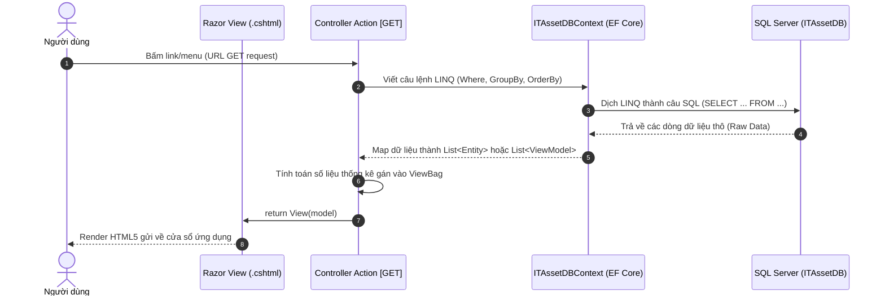
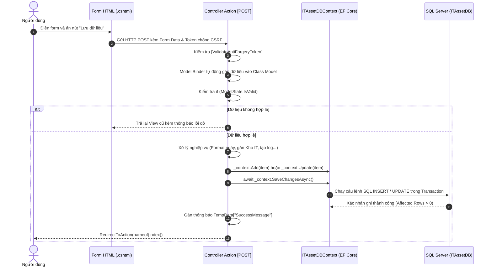

# CẨM NANG TOÀN DIỆN VỀ KIẾN TRÚC, LUỒNG DỮ LIỆU & LỘ TRÌNH LÀM CHỦ DỰ ÁN
**Dự án:** Hoàng Anh Group IT Asset Management  
**Mục tiêu tài liệu:**  
1. Làm tài liệu học tập cốt lõi để bạn hiểu sâu toàn bộ hệ thống từ A-Z.  
2. Làm cẩm nang kỹ thuật & quản trị để trả lời rõ ràng, tự tin, đúng trọng tâm khi trao đổi với Sếp.

---

## MỤC LỤC
1. [Tổng quan Kiến trúc Hệ thống (System Architecture)](#1-tổng-quan-kiến-trúc-hệ-thống-system-architecture)
2. [Mô hình Code MVC & Cấu trúc Thư mục](#2-mô-hình-code-mvc--cấu-trúc-thư-mục)
3. [Luồng Dữ liệu Tổng quát (General Data Flow)](#3-luồng-dữ-liệu-tổng-quát-general-data-flow)
4. [Các Use Case Thực tế & Luồng Dữ liệu Chi tiết (Kèm Class & File cụ thể)](#4-các-use-case-thực-tế--luồng-dữ-liệu-chi-tiết)
   - [Use Case 1: Nhập máy mới về Kho IT dự phòng](#use-case-1-nhập-máy-mới-về-kho-it-dự-phòng)
   - [Use Case 2: Cấp phát thiết bị cho Nhân sự & Xuất biên bản Word](#use-case-2-cấp-phát-thiết-bị-cho-nhân-sự--xuất-biên-bản-word)
   - [Use Case 3: Thu hồi thiết bị khi nhân sự nghỉ việc](#use-case-3-thu-hồi-thiết-bị-khi-nhân-sự-nghỉ-việc)
   - [Use Case 4: Gom nhóm hiển thị Phần mềm Cài đặt](#use-case-4-gom-nhóm-hiển-thị-phần-mềm-cài-đặt)
   - [Use Case 5: Kiểm soát giới hạn License dùng chung (Active Account)](#use-case-5-kiểm-soát-giới-hạn-license-dùng-chung-active-account)
   - [Use Case 6: Lập kế hoạch bảo trì thiết bị hàng loạt](#use-case-6-lập-kế-hoạch-bảo-trì-thiết-bị-hàng-loạt)
5. [Bản chất Vận hành Desktop & Cơ sở Dữ liệu SQL Server](#5-bản-chất-vận-hành-desktop--cơ-sở-dữ-liệu-sql-server)
6. [Bộ Câu hỏi & Trả lời Cốt lõi khi Trao đổi với Sếp](#6-bộ-câu-hỏi--trả-lời-cốt-lõi-khi-trao-đổi-với-sếp)
7. [Lộ trình 5 Bước để Tự Học & Làm Chủ Toàn Bộ Dự Án](#7-lộ-trình-5-bước-để-tự-học--làm-chủ-toàn-bộ-dự-án)

---

## 1. TỔNG QUAN KIẾN TRÚC HỆ THỐNG (SYSTEM ARCHITECTURE)

Hệ thống được thiết kế theo mô hình **Desktop Hybrid**: Giao diện và nghiệp vụ xử lý bằng web chuẩn ASP.NET Core MVC (.NET 10), nhưng được đóng gói thành một ứng dụng Desktop chạy độc lập trên Windows (.exe).

```
┌────────────────────────────────────────────────────────────────────────┐
│                        TẦNG GIAO DIỆN (DESKTOP UI)                     │
│  - Cửa sổ Native Windows được mở bởi thư viện Photino.NET             │
│  - Render HTML5 / CSS3 (Bootstrap 5) / JavaScript qua Microsoft Edge   │
│    WebView2 Engine                                                     │
└───────────────────────────────────▲────────────────────────────────────┘
                                    │ HTTP Localhost (127.0.0.1:5000)
┌───────────────────────────────────▼────────────────────────────────────┐
│                    TẦNG WEB SERVER NHÚNG (KESTREL)                     │
│  - Nhúng trực tiếp bên trong tiến trình ITAssetManagement.exe          │
│  - Tiếp nhận Request, điều phối Middleware, kiểm tra CSRF Token        │
└───────────────────────────────────▲────────────────────────────────────┘
                                    │
┌───────────────────────────────────▼────────────────────────────────────┐
│                  TẦNG ĐIỀU PHỐI NGHIỆP VỤ (CONTROLLERS)                │
│  - ThietBiController, BienBanController, UsersController...           │
│  - Kiểm tra Validation (ModelState.IsValid), thực thi luật nghiệp vụ   │
│  - Xử lý File Word OpenXML, tính toán niên hạn 36 tháng...            │
└───────────────────────────────────▲────────────────────────────────────┘
                                    │ C# Object / LINQ
┌───────────────────────────────────▼────────────────────────────────────┐
│               TẦNG DATA ACCESS (ENTITY FRAMEWORK CORE 10)              │
│  - ITAssetDBContext: Quản lý kết nối, ánh xạ bảng C# sang SQL          │
│  - Change Tracker: Tự động phát hiện dữ liệu thêm/sửa/xóa              │
└───────────────────────────────────▲────────────────────────────────────┘
                                    │ TCP/IP Port 1433 hoặc Shared Memory
┌───────────────────────────────────▼────────────────────────────────────┐
│             CƠ SỞ DỮ LIỆU (SQL SERVER WINDOWS SERVICE)                 │
│  - Dịch vụ nền: MSSQLSERVER hoặc MSSQL$SQLEXPRESS (sqlservr.exe)       │
│  - Database: ITAssetDB (Các bảng ThietBi, Users, License, LichSu...)   │
└────────────────────────────────────────────────────────────────────────┘
```

---

## 2. MÔ HÌNH CODE MVC & CẤU TRÚC THƯ MỤC

### 2.1. Cấu trúc thư mục thực tế trong source code
```
ITAssetManagement/
├── Program.cs                  # Khởi tạo DI, Kestrel Server và Photino Desktop
├── appsettings.json            # Lưu Connection String kết nối SQL Server
├── Controllers/                # Tầng Controller (Bộ não điều phối)
│   ├── ThietBiController.cs
│   ├── BienBanController.cs
│   ├── ApplicationSoftwareController.cs
│   ├── LicenseController.cs
│   ├── BaoTriController.cs
│   └── UsersController.cs
├── Models/                     # Tầng Data Models & ViewModels
│   ├── ITAssetDBContext.cs     # Cầu nối CSDL với EF Core
│   ├── ThietBi.cs              # Entity: Bảng thiết bị
│   ├── User.cs                 # Entity: Bảng nhân sự
│   ├── License.cs              # Entity: Bảng bản quyền phần mềm
│   ├── ApplicationSoftware.cs  # Entity: Bảng phần mềm cài đặt
│   ├── LichSuDieuChuyen.cs     # Entity: Bảng lịch sử luân chuyển
│   ├── LichSuBaoTri.cs         # Entity: Bảng kế hoạch & sửa chữa
│   ├── BienBanViewModel.cs     # ViewModel: Phục vụ xuất & in biên bản
│   ├── UserAppGroupViewModel.cs# ViewModel: Phục vụ gom nhóm phần mềm theo User
│   └── LicenseUsageStat.cs     # Helper: Thống kê định mức 10 máy/license
├── Views/                      # Tầng View (Giao diện Razor .cshtml)
│   ├── ThietBi/ (Index, Create, Edit, Details)
│   ├── BienBan/ (Index, Create, Preview)
│   ├── ApplicationSoftware/ (Index, Create, Edit)
│   └── Shared/_Layout.cshtml   # Khung giao diện chung (Sidebar, Navbar)
└── wwwroot/                    # File tĩnh (CSS, JS, Hình ảnh, Bootstrap)
```

---

### 2.2. Trách nhiệm của từng thành phần MVC
1. **Model (Dữ liệu):**
   - **Entity Model:** Class C# ánh xạ trực tiếp 1-1 với bảng trong SQL Server.
   - **ViewModel:** Class C# tự chế, chỉ dùng để gom hoặc lọc dữ liệu phục vụ riêng cho một màn hình hiển thị (tránh đưa cả bảng DB ra ngoài giao diện).
2. **View (Giao diện):**
   - Các file đuôi `.cshtml` kết hợp giữa HTML5 và cú pháp C# Razor (`@`).
   - View không truy vấn database, nó chỉ nhận dữ liệu từ Controller đưa sang để hiển thị.
3. **Controller (Bộ não):**
   - Đứng giữa View và Model. Nhận hành động của người dùng, gọi `ITAssetDBContext` để đọc/ghi database, sau đó chọn View thích hợp để trả về.

---

## 3. LUỒNG DỮ LIỆU TỔNG QUÁT (GENERAL DATA FLOW)

Mọi thao tác trong phần mềm đều đi theo một trong hai luồng chuẩn sau:

### Luồng Đọc (HTTP GET: Từ SQL Server lên Màn hình)


---

### Luồng Ghi (HTTP POST: Từ Form nhập liệu xuống SQL Server)


---

## 4. CÁC USE CASE THỰC TẾ & LUỒNG DỮ LIỆU CHI TIẾT

Đây là phần quan trọng nhất giúp bạn giải thích chính xác từng tính năng hoạt động ra sao, đi qua những file nào, class nào.

---

### Use Case 1: Nhập máy mới về Kho IT dự phòng
* **Nghiệp vụ thực tế:** Công ty mua một lô laptop mới về, IT bóc seal, kiểm tra cấu hình, nhập máy vào phần mềm nhưng **chưa bàn giao cho ai**; máy phải sẵn sàng ở trạng thái Kho dự phòng.

#### File & Class tham gia:
- **View:** `Views/ThietBi/Create.cshtml`
- **Controller:** `Controllers/ThietBiController.cs` (Action `Create`)
- **Entity Model:** `Models/ThietBi.cs`, `Models/LichSuDieuChuyen.cs`
- **Context:** `Models/ITAssetDBContext.cs`
- **Bảng CSDL:** `ThietBi`, `LichSuDieuChuyen`

#### Luồng dữ liệu chạy từng bước:
1. IT vào menu **Thiết bị IT** $\to$ bấm **Thêm thiết bị mới** (gọi `ThietBiController.Create()` [GET]). Controller nạp danh sách User vào `ViewBag.Users`.
2. Trên form `Create.cshtml`:
   - IT nhập Model: `HP ProBook 440 G10`, Serial: `5CD123456`.
   - Chọn ngày đầu tư: `09/11/2026`.
   - Bấm nút **"Tự tính +36 tháng"**: Hàm JavaScript `setWarrantyMonths(36)` tự tính ra HSD là `09/11/2029`.
   - **Để trống ô "Người sử dụng"** (hoặc gõ `Kho IT`).
3. Bấm **Lưu thiết bị**: Form gửi POST về `ThietBiController.Create(ThietBi thietBi)`:
   - Gọi hàm `FormatDateToDb()`: Chuẩn hóa chuỗi ngày từ datepicker (`2026-11-09`) về định dạng hệ thống (`11/09/2026`).
   - **Thực thi Logic tự động vào Kho:**
     ```csharp
     bool isNhapKho = string.IsNullOrWhiteSpace(thietBi.Owner) || thietBi.Owner.Trim().ToLower() == "kho it";
     if (isNhapKho)
     {
         thietBi.Owner = "Kho IT";
         thietBi.UserId = null;
         thietBi.PhongBan = "IT";
     }
     ```
   - Gọi `_context.Add(thietBi)` và `await _context.SaveChangesAsync()`. Lúc này máy có `Id` mới trong bảng `ThietBi`.
   - **Tự động ghi vết vào bảng `LichSuDieuChuyen`:**
     ```csharp
     var history = new LichSuDieuChuyen {
         ThietBiId = thietBi.Id,
         ThietBiSerial = thietBi.SerialNumber,
         LoaiHanhDong = "Nhập kho mới",
         OwnerCu = "Nhà cung cấp / Mua mới",
         OwnerMoi = "Kho IT",
         Ngay = thietBi.ThoiGianDauTu,
         ChiTiet = "Ghi nhận tài sản mới vào Kho IT..."
     };
     _context.LichSuDieuChuyen.Add(history);
     await _context.SaveChangesAsync();
     ```
4. Hệ thống redirect về `Index`: Màn hình hiển thị badge xanh lá cây `[📦 Kho IT]`.

---

### Use Case 2: Cấp phát thiết bị cho Nhân sự & Xuất biên bản Word
* **Nghiệp vụ thực tế:** Nhân viên Nguyễn Thị Xíu (Phòng Flavor) vào nhận việc. IT lấy 1 chiếc máy đang ở Kho IT cấp phát cho nhân viên này và in Biên bản bàn giao Word cho 2 bên ký tên.

#### File & Class tham gia:
- **View:** `Views/BienBan/Create.cshtml`
- **Controller:** `Controllers/BienBanController.cs` (Action `Create`, `ExportWord`, `SaveHistory`)
- **ViewModel:** `Models/BienBanViewModel.cs`
- **Entity Model:** `Models/ThietBi.cs`, `Models/User.cs`, `Models/License.cs`, `Models/LichSuDieuChuyen.cs`
- **File mẫu Word:** `data/Bienban/CapPhat/CapphatTBCNTT.docx`

#### Luồng dữ liệu chạy từng bước:

```
[Bấm Cấp phát] 
      │
      ▼
BienBanController.Create(loai="Cấp phát", thietBiId, userId) [GET]
      │
      ├─► Sinh số biên bản: DateTime.Now.ToString("yyMMdd.HHmmss")
      ├─► Nạp CPU, RAM, Ổ cứng từ ThietBi -> Ghép vào BienBanViewModel.DacTinhKyThuat
      ├─► Nạp thông tin User -> Tìm bảng License lấy Domain_Name và Email_M365
      └─► Return View(model)
```

1. **Khởi tạo dữ liệu:**
   - Trên màn hình `BienBan/Create`, IT chọn thiết bị đang nằm ở Kho IT và chọn nhân sự nhận máy.
   - `BienBanViewModel` tự động điền đầy đủ cấu hình máy, thời gian cấp và tài khoản email Microsoft 365 của nhân sự.
2. **Xuất file Word OpenXML (`ExportWord` POST):**
   - Khi IT bấm **"Xuất file Word"**, Controller đọc trực tiếp file mẫu `.docx` thông qua thư viện `System.IO.Compression.ZipArchive`.
   - Mở file XML bên trong `word/document.xml`.
   - Tìm và thay thế các từ khóa:
     `«SoBienBan»` $\to$ số biên bản;  
     `«NguoiNhan»` $\to$ Nguyễn Thị Xíu;  
     `«TenThietBi»` $\to$ HP ProBook 440;  
     `«DacTinhKyThuat»` $\to$ Core i5, RAM 16GB, SSD 512GB;  
     `«Email_M365»` $\to$ xiu.nguyen@hoanganh.com.
   - Tự động xóa thẻ `<w:mailMerge>` trong `word/settings.xml` để khi mở file Word không bị lỗi cảnh báo SQL.
   - Stream file `.docx` trả về trình duyệt tải xuống.
3. **Cập nhật trạng thái máy & Ghi nhận lịch sử (`SaveHistory` POST):**
   - Khi IT bấm **"Lưu lịch sử điều chuyển"**:
     - Controller tự động cập nhật bảng `ThietBi`: `thietBi.Owner = "Nguyễn Thị Xíu"`, `thietBi.PhongBan = "Flavor"`.
     - Tự động ghi 1 dòng mới vào bảng `LichSuDieuChuyen` với `LoaiHanhDong = "Cấp phát"`.
   - Kết thúc: Máy chính thức đổi chủ, không còn nằm trong Kho IT.

---

### Use Case 3: Thu hồi thiết bị khi nhân sự nghỉ việc
* **Nghiệp vụ thực tế:** Nhân viên nghỉ việc, IT làm thủ tục thu hồi máy tính và tài khoản về lại phòng IT.

#### File & Class tham gia:
- **Controller:** `Controllers/BienBanController.cs` (Action `Create`, `SaveHistory`)
- **ViewModel:** `Models/BienBanViewModel.cs`
- **Entity Model:** `Models/ThietBi.cs`, `Models/LichSuDieuChuyen.cs`

#### Luồng dữ liệu chạy từng bước:
1. IT vào **Biên bản bàn giao** $\to$ chọn loại biên bản **"Thu hồi"**.
2. Chọn tên nhân sự trả máy $\to$ Hệ thống tự động nạp danh sách thiết bị nhân sự đó đang giữ.
3. Bấm **"Lưu lịch sử điều chuyển"**:
   - Controller tìm thiết bị theo `thietBiId`:
     ```csharp
     dev.Owner = "Kho IT";
     dev.PhongBan = "IT";
     dev.UserId = null;
     ```
   - Tạo bản ghi trong `LichSuDieuChuyen`:
     - `OwnerCu`: "Nguyễn Thị Xíu"
     - `OwnerMoi`: "Kho IT / Dự phòng"
     - `LoaiHanhDong`: "Thu hồi"
     - `LyDo`: "Nghỉ việc"
4. Kết quả: Thiết bị lập tức quay về trạng thái **Kho IT**, sẵn sàng để kiểm tra, vệ sinh và cấp tiếp cho nhân viên mới.

---

### Use Case 4: Gom nhóm hiển thị Phần mềm Cài đặt
* **Nghiệp vụ thực tế:** Quản trị viên muốn xem danh mục phần mềm không phải dạng một bảng dài ngoằng hàng trăm dòng lặp tên người, mà muốn gom lại: **1 nhân sự $\to$ danh sách 5-10 phần mềm họ đang dùng**.

#### File & Class tham gia:
- **Controller:** `Controllers/ApplicationSoftwareController.cs` (Action `Index`)
- **Entity Model:** `Models/ApplicationSoftware.cs`
- **ViewModel:** `Models/UserAppGroupViewModel.cs`
- **View:** `Views/ApplicationSoftware/Index.cshtml`

#### Luồng dữ liệu chạy từng bước:
1. Trong SQL Server, bảng `ApplicationSoftware` lưu dữ liệu dạng phẳng (mỗi dòng là 1 phần mềm của 1 người).
2. Controller gọi EF Core lấy toàn bộ danh sách:
   ```csharp
   var list = await _context.ApplicationSoftwares.ToListAsync();
   ```
3. Sử dụng toán tử **LINQ `GroupBy`** để gom các dòng có chung `Owner`, `PhongBan`, `May`:
   ```csharp
   var grouped = list
       .GroupBy(a => new { a.Owner, a.PhongBan, a.May, a.UserId })
       .Select(g => new UserAppGroupViewModel {
           Owner = g.Key.Owner,
           PhongBan = g.Key.PhongBan,
           May = g.Key.May,
           Apps = g.ToList() // Gom toàn bộ phần mềm của người này vào List
       })
       .ToList();
   ```
4. Truyền `grouped` sang View: `return View(grouped);`.
5. View `Index.cshtml` nhận `@model IEnumerable<UserAppGroupViewModel>`, chạy vòng lặp hiển thị từng Card nhân sự, bên trong có danh sách phần mềm (Office, AutoCAD, ERP...) kèm loại bản quyền.

---

### Use Case 5: Kiểm soát giới hạn License dùng chung (Active Account)
* **Nghiệp vụ thực tế:** Một tài khoản Microsoft 365 hoặc phần mềm đồ họa chỉ được phép cài tối đa trên 10 máy. Nếu vượt quá thì hệ thống phải cảnh báo vi phạm bản quyền.

#### File & Class tham gia:
- **Controller:** `Controllers/LicenseController.cs` (Action `Index`)
- **Entity Model:** `Models/License.cs`
- **Helper Model:** `Models/LicenseUsageStat.cs`
- **View:** `Views/License/Index.cshtml`

#### Luồng dữ liệu chạy từng bước:
1. Controller truy vấn các dòng trong bảng `License` có cột `ActiveAccount` không rỗng:
   ```csharp
   var activeLicenses = await _context.Licenses.Where(...).ToListAsync();
   ```
2. Gom nhóm theo từng tài khoản kích hoạt và khởi tạo đối tượng `LicenseUsageStat`:
   ```csharp
   var accountStats = activeLicenses
       .GroupBy(l => l.ActiveAccount.Trim())
       .Select(g => new LicenseUsageStat {
           ActiveAccount = g.Key,
           Count = g.Count(), // Đếm số máy đang kích hoạt
           Limit = 10,        // Định mức chuẩn
           Owners = g.Select(x => x.Owner).Distinct().ToList(),
           ComputerNames = g.Select(x => x.ComputerName).Distinct().ToList()
       }).ToList();
   ```
3. Trong class `LicenseUsageStat` có thuộc tính logic:
   ```csharp
   public bool IsOverLimit => Count > Limit;
   ```
4. View kiểm tra: Nếu `stat.IsOverLimit == true`, hiển thị thanh tiến trình màu đỏ kèm nhãn **Vượt định mức** để IT kịp thời thu hồi hoặc mua bổ sung bản quyền.

---

### Use Case 6: Lập kế hoạch bảo trì thiết bị hàng loạt
* **Nghiệp vụ thực tế:** Đến kỳ bảo dưỡng quý, IT cần lên lịch bảo trì định kỳ cho toàn bộ 20 máy tính thuộc phòng Kế toán chỉ bằng một thao tác bấm.

#### File & Class tham gia:
- **Controller:** `Controllers/BaoTriController.cs` (Action `CreateBatch`)
- **Entity Model:** `Models/LichSuBaoTri.cs`, `Models/ThietBi.cs`
- **View:** `Views/BaoTri/Index.cshtml`

#### Luồng dữ liệu chạy từng bước:
1. IT tích chọn danh sách thiết bị trên màn hình hoặc chọn theo phòng ban.
2. Form gửi mảng các mã thiết bị `List<int> deviceIds` lên Controller qua phương thức POST:
   ```csharp
   [HttpPost]
   public async Task<IActionResult> CreateBatch(List<int> deviceIds, string tieuDe, string ngayDuKien)
   ```
3. Controller truy vấn thông tin của toàn bộ các máy được chọn:
   ```csharp
   var devices = await _context.ThietBis.Where(t => deviceIds.Contains(t.Id)).ToListAsync();
   ```
4. Khởi tạo danh sách các bản ghi `LichSuBaoTri`:
   ```csharp
   var batchRecords = new List<LichSuBaoTri>();
   foreach (var dev in devices) {
       batchRecords.Add(new LichSuBaoTri {
           ThietBiId = dev.Id,
           Model = dev.Model,
           SerialNumber = dev.SerialNumber,
           TieuDe = tieuDe,
           TrangThai = "Kế hoạch",
           NgayDuKien = ngayDuKien
       });
   }
   ```
5. Ghi vào database trong một Transaction duy nhất:
   ```csharp
   _context.LichSuBaoTris.AddRange(batchRecords);
   await _context.SaveChangesAsync();
   ```
6. Kết quả: Toàn bộ 20 máy đều xuất hiện trên lịch bảo trì tháng (`Calendar View`).

---

## 5. BẢN CHẤT VẬN HÀNH DESKTOP & CƠ SỞ DỮ LIỆU SQL SERVER

### 5.1. Tại sao không bật SSMS mà ứng dụng vẫn chạy bình thường?
Đây là câu hỏi nền tảng về hệ điều hành và cơ sở dữ liệu:
* **SSMS (SQL Server Management Studio)** chỉ là một **phần mềm đồ họa (Client Tool)** để con người nhìn thấy bảng biểu, gõ lệnh SQL bằng tay — tương tự như mở file bằng Notepad hay mở web bằng Chrome. Bản thân SSMS **không phải là CSDL**.
* **Trái tim CSDL thực sự** là một **Windows Service** chạy ngầm dưới hệ điều hành, có tên là `MSSQLSERVER` hoặc `MSSQL$SQLEXPRESS` (tập tin thực thi `sqlservr.exe`).
  - Dịch vụ này tự động kích hoạt ngay khi máy tính khởi động (`Startup: Automatic`).
  - Nó chiếm bộ nhớ RAM và liên tục lắng nghe kết nối tại cổng mạng nội bộ (mặc định TCP 1433 hoặc Shared Memory).
* **Ứng dụng .NET** kết nối trực tiếp đến Service ngầm này thông qua chuỗi kết nối (`Connection String` trong `appsettings.json`):
  ```json
  "Server=localhost\\SQLEXPRESS;Database=ITAssetDB;Trusted_Connection=True;..."
  ```
* Vì vậy: **Dù bạn đóng SSMS hoặc thậm chí gỡ bỏ hoàn toàn SSMS khỏi máy tính, ứng dụng vẫn đọc/ghi CSDL bình thường 100%.**

---

### 5.2. Cơ chế Desktop Hybrid (Photino + Kestrel)
* **Kestrel Server nhúng:** Khi bạn click đúp vào file `.exe`, .NET tự kích hoạt một Web Server Kestrel siêu nhẹ chạy ngầm ngay trong bộ nhớ RAM, phục vụ tại địa chỉ `http://127.0.0.1:5000`. Không cần cài đặt IIS hay web server cồng kềnh.
* **Cửa sổ Photino Native:** Thư viện Photino tận dụng nhân trình duyệt Microsoft Edge WebView2 có sẵn trên Windows để mở ra một cửa sổ độc lập, giấu đi thanh địa chỉ web, mang lại trải nghiệm bấm đúp là chạy như một phần mềm Windows Native thuần túy.

---

## 6. BỘ CÂU HỎI & TRẢ LỜI CỐT LÕI KHI TRAO ĐỔI VỚI SẾP

Khi trao đổi với Ban Giám đốc hoặc Sếp, hãy giữ phong thái **gãy gọn, tự tin, tập trung vào giá trị thực tế và an toàn dữ liệu**, tránh dùng thuật ngữ kỹ thuật quá sâu:

#### Câu 1: "Tại sao công ty không dùng tiếp Excel mà phải làm phần mềm này?"
> **Trả lời:**  
> *"Dạ, Excel chỉ ghi chép thụ động, ai bấm nhầm phím Delete hoặc gõ sai cũng làm mất dữ liệu gốc của cả công ty mà không biết ai sửa.  
> Quan trọng nhất là Excel không thể tự động hóa: Phần mềm này kiểm soát toàn bộ vòng đời tài sản (từ lúc mua vào Kho IT, cấp cho ai, đến lúc nghỉ việc thu hồi máy). Ngoài ra, phần mềm **tự động sinh Biên bản bàn giao Word có chữ ký pháp lý chỉ trong 1 click**, tiết kiệm rất nhiều giờ công giấy tờ và đảm bảo tài sản không bị thất thoát."*

#### Câu 2: "Phần mềm này có tốn chi phí thuê bao hay bản quyền hàng tháng không?"
> **Trả lời:**  
> *"Dạ hoàn toàn **0 đồng chi phí duy trì** ạ. Hệ thống này do đội ngũ IT nội bộ tự phát triển trên nền tảng của Microsoft (.NET và SQL Server). Công ty mình sở hữu vĩnh viễn mã nguồn, tiết kiệm hàng chục triệu mỗi năm so với việc đi thuê phần mềm quản trị bên ngoài thị trường, và sau này công ty có quy định gì mới thì IT đều chủ động nâng cấp được ngay."*

#### Câu 3: "Dữ liệu lưu ở đâu? Có sợ bị lộ ra ngoài mạng hoặc mất dữ liệu không?"
> **Trả lời:**  
> *"Dạ dữ liệu được lưu trên **Cơ sở dữ liệu SQL Server nội bộ (On-Premise)** trong hệ thống máy chủ công ty, hoàn toàn không đẩy lên đám mây công cộng nên không lo bị rò rỉ thông tin ra ngoài. CSDL có cơ chế sao lưu tự động định kỳ (backup file `.bak`), nếu máy tính có sự cố phần cứng thì chỉ mất 10 phút là khôi phục lại nguyên vẹn."*

#### Câu 4: "Nếu mất mạng Internet thì ứng dụng có chạy được không?"
> **Trả lời:**  
> *"Dạ phần mềm chạy hoàn toàn trong mạng nội bộ văn phòng (mạng LAN). Dù có mất kết nối Internet quốc tế thì việc quản lý thiết bị, in biên bản bàn giao vẫn hoạt động bình thường 100% không bị gián đoạn ạ."*

#### Câu 5: "Sau này nếu em bận việc khác, người mới vào có quản trị và sửa được code này không?"
> **Trả lời:**  
> *"Dạ phần mềm được xây dựng tuân thủ 100% theo **kiến trúc MVC chuẩn quốc tế của Microsoft**. Đây là kiến thức chuẩn mực mà bất kỳ kỹ sư phần mềm .NET nào cũng nắm rõ. Toàn bộ mã nguồn đã được tài liệu hóa chi tiết từ cấu trúc database đến luồng code trong file cẩm nang kỹ thuật này, người mới vào chỉ cần đọc qua là tiếp quản được ngay."*

---

## 7. LỘ TRÌNH 5 BƯỚC ĐỂ TỰ HỌC & LÀM CHỦ TOÀN BỘ DỰ ÁN

Để tự tin làm chủ và phát triển thêm bất kỳ tính năng nào cho dự án, bạn nên học tuần tự theo 5 bước sau:

```
┌────────────────────────────────────────────────────────┐
│ BƯỚC 1: Nắm chắc C# Class, Properties & OOP Căn bản    │
│ -> Hiểu cách 1 đối tượng ThietBi, User được tạo ra.    │
└───────────────────────────┬────────────────────────────┘
                            │
┌───────────────────────────▼────────────────────────────┐
│ BƯỚC 2: Hiểu Mô hình MVC & Cơ chế Định tuyến (Routing) │
│ -> Hiểu URL /ThietBi/Create gọi đến Action nào.        │
└───────────────────────────┬────────────────────────────┘
                            │
┌───────────────────────────▼────────────────────────────┐
│ BƯỚC 3: Làm chủ Entity Framework Core & Cú pháp LINQ   │
│ -> Học cách viết Where(), GroupBy(), SaveChangesAsync() │
└───────────────────────────┬────────────────────────────┘
                            │
┌───────────────────────────▼────────────────────────────┐
│ BƯỚC 4: Hiểu Model Binding & Form Validation           │
│ -> Hiểu cách dữ liệu từ thẻ <input> chui vào biến C#.  │
└───────────────────────────┬────────────────────────────┘
                            │
┌───────────────────────────▼────────────────────────────┐
│ BƯỚC 5: Đọc mã nguồn Dự án theo đúng thứ tự logic      │
│ Program.cs -> ITAssetDBContext -> Models -> Controllers│
└────────────────────────────────────────────────────────┘
```

### Chi tiết các tài liệu khuyên đọc cho từng bước:
1. **Bước 1 & 2 (C# & MVC):**
   - Đọc: [Tổng quan về ASP.NET Core MVC (Microsoft Learn)](https://learn.microsoft.com/vi-vn/aspnet/core/mvc/overview)
   - Xem: [Full Course ASP.NET Core MVC trên freeCodeCamp (Miễn phí)](https://www.youtube.com/watch?v=BfEjDD8mWYg)
2. **Bước 3 (Entity Framework Core & LINQ):**
   - Đọc: [Truy vấn dữ liệu với LINQ trong EF Core](https://learn.microsoft.com/vi-vn/ef/core/querying/)
   - Thực hành: Tự viết thử các câu lệnh lọc `Where(t => t.Owner == ...)` và gom nhóm `GroupBy(...)`.
3. **Bước 4 (Model Binding & Validation):**
   - Đọc: [Model Binding trong ASP.NET Core](https://learn.microsoft.com/vi-vn/aspnet/core/mvc/models/model-binding)
   - Đọc: [Model Validation trong ASP.NET Core](https://learn.microsoft.com/vi-vn/aspnet/core/mvc/models/validation)
4. **Bước 5 (Đọc code thực tế trong dự án của bạn):**
   - Mở `ITAssetDBContext.cs` xem các bảng `DbSet`.
   - Mở `ThietBiController.cs` xem cách viết hàm `Create` và `Edit`.
   - Mở `BienBanController.cs` xem cách giải nén OpenXML đọc file Word.

---
*Tài liệu được biên soạn và chuẩn hóa phục vụ công tác đào tạo nội bộ & báo cáo quản trị.*
