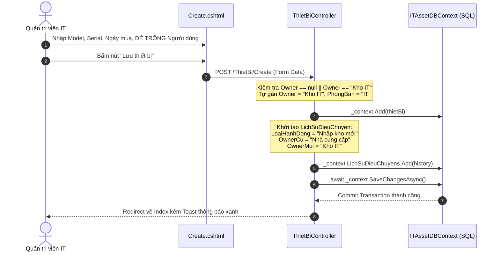

# BÁO CÁO CHUYÊN ĐỀ KIẾN TRÚC HỆ THỐNG & CÔNG NGHỆ PHẦN MỀM
# ĐỀ TÀI: HỆ THỐNG QUẢN TRỊ VÒNG ĐỜI TÀI SẢN CNTT DOANH NGHIỆP (IT ASSET MANAGEMENT PRO)

**Học viên / Kỹ sư thực hiện:** Đội ngũ Kỹ thuật CNTT Hoàng Anh Group  
**Nền tảng công nghệ:** ASP.NET Core (.NET 10) | Entity Framework Core | Microsoft SQL Server | Photino Desktop Hybrid  
**Mục tiêu tài liệu:**  
1. Đóng vai trò như một **báo cáo tiểu luận / khóa luận chuyên đề** hoàn chỉnh, trình bày chuẩn mực về mặt lý thuyết, phương pháp luận và cơ sở khoa học để báo cáo với Hội đồng / Thầy Cô / Ban Giám đốc.  
2. Cung cấp **tài liệu kỹ thuật thực chiến chi tiết** về luồng dữ liệu, cấu trúc class và use case thực tế để tự học và làm chủ toàn bộ mã nguồn dự án.

---

## MỤC LỤC TỔNG QUAN

- [CHƯƠNG 1: TỔNG QUAN ĐỀ TÀI & BỐI CẢNH BÀI TOÁN](#chương-1-tổng-quan-đề-tài--bối-cảnh-bài-toán)
- [CHƯƠNG 2: CƠ SỞ LÝ THUYẾT & CÁC KHÁI NIỆM NỀN TẢNG](#chương-2-cơ-sở-lý-thuyết--các-khái-niệm-nền-tảng)
- [CHƯƠNG 3: PHÂN TÍCH QUYẾT ĐỊNH KIẾN TRÚC: TẠI SAO CHỌN MÔ HÌNH NÀY?](#chương-3-phân-tích-quyết-định-kiến-trúc-tại-sao-chọn-mô-hình-này)
- [CHƯƠNG 4: THIẾT KẾ KIẾN TRÚC HỆ THỐNG & VÒNG ĐỜI DỮ LIỆU](#chương-4-thiết-kế-kiến-trúc-hệ-thống--vòng-đời-dữ-liệu)
- [CHƯƠNG 5: HIỆN THỰC HÓA CÁC USE CASE THỰC TẾ & MAPPING CLASS/FILE](#chương-5-hiện-thực-hóa-các-use-case-thực-tế--mapping-classfile)
- [CHƯƠNG 6: BẢN CHẤT VẬN HÀNH DESKTOP HYBRID & DỊCH VỤ CƠ SỞ DỮ LIỆU](#chương-6-bản-chất-vận-hành-desktop-hybrid--dịch-vụ-cơ-sở-dữ-liệu)
- [CHƯƠNG 7: ĐÁNH GIÁ CHẤT LƯỢNG HỆ THỐNG, HẠN CHẾ & HƯỚNG PHÁT TRIỂN](#chương-7-đánh-giá-chất-lượng-hệ-thống-hạn-chế--hướng-phát-triển)
- [CHƯƠNG 8: BỘ CÂU HỎI PHẢN BIỆN KHI BÁO CÁO HỘI ĐỒNG / BAN GIÁM ĐỐC](#chương-8-bộ-câu-hỏi-phản-biện-khi-báo-cáo-hội-đồng--ban-giám-đốc)
- [CHƯƠNG 9: LỘ TRÌNH 5 BƯỚC ĐỂ LÀM CHỦ TOÀN BỘ MÃ NGUỒN](#chương-9-lộ-trình-5-bước-để-làm-chủ-toàn-bộ-mã-nguồn)

---

## CHƯƠNG 1: TỔNG QUAN ĐỀ TÀI & BỐI CẢNH BÀI TOÁN

### 1.1. Bối cảnh thực tiễn
Trong các doanh nghiệp sản xuất và thương mại quy mô vừa và lớn như Tập đoàn Hoàng Anh, số lượng trang thiết bị công nghệ thông tin (máy trạm, máy tính xách tay, máy in, thiết bị mạng, camera) và bản quyền phần mềm (Microsoft 365, AutoCAD, ERP SAP/B1) lên tới hàng trăm, hàng ngàn thực thể.

### 1.2. Hạn chế của phương pháp quản lý truyền thống (Excel/Spreadsheets)
1. **Thiếu kiểm soát toàn vẹn dữ liệu (Lack of Data Integrity):** Dữ liệu phân tán trên nhiều file cá nhân, dễ bị chỉnh sửa nhầm, xóa dòng mà không có cơ chế kiểm tra kiểu dữ liệu (Validation).
2. **Xung đột phiên bản và đồng thời (Concurrency Conflicts):** Khi nhiều quản trị viên IT cùng cập nhật một file Excel trên OneDrive/mạng chia sẻ nội bộ, hiện tượng đè file (`v1`, `v2_final`) xảy ra thường xuyên, làm mất dấu lịch sử tài sản.
3. **Mất dấu vòng đời thiết bị (Asset Lifecycle Blindspots):** Khi nhân sự nghỉ việc hoặc đổi phòng ban, thiết bị dễ bị "quên" thu hồi linh kiện (RAM, màn hình rời), hoặc không nắm được máy nào đang tồn kho dự phòng để tái cấp phát.
4. **Chi phí thời gian cho quy trình hành chính (Administrative Overhead):** Mỗi đợt bàn giao/thu hồi máy tính, nhân viên IT phải gõ tay cấu hình vào file Microsoft Word mẫu, mất trung bình 15–20 phút/biên bản và tiềm ẩn sai sót số Serial Number.

### 1.3. Mục tiêu nghiên cứu và phát triển đề tài
Xây dựng một giải pháp phần mềm chuyên dụng, tự chủ 100% công nghệ nội bộ, đảm bảo 3 tiêu chí:
* **Tự động hóa toàn diện:** Quản lý vòng đời khép kín (Mua mới $\to$ Kho IT $\to$ Cấp phát $\to$ Thu hồi về kho) và sinh Biên bản bàn giao Word chuẩn pháp lý chỉ trong 1 click.
* **Toàn vẹn và an toàn:** Lưu trữ tập trung trên hệ quản trị CSDL quan hệ Microsoft SQL Server, đảm bảo tính nhất quán và bảo vệ dữ liệu.
* **Chi phí định kỳ bằng 0:** Ứng dụng mô hình Desktop Hybrid chạy trên hạ tầng On-Premise nội bộ, không phát sinh chi phí mua bản quyền phần mềm SaaS hàng tháng.

---

## CHƯƠNG 2: CƠ SỞ LÝ THUYẾT & CÁC KHÁI NIỆM NỀN TẢNG

Để bảo vệ và trình bày đồ án một cách chuẩn mực, cần nắm vững 6 khái niệm khoa học máy tính cốt lõi sau:

### 2.1. Kiến trúc MVC (Model - View - Controller) & Nguyên lý SoC (Separation of Concerns)
* **Khái niệm:** MVC là mẫu kiến trúc phần mềm phân chia ứng dụng thành 3 thành phần có trách nhiệm hoàn toàn độc lập:
  - **Model (Dữ liệu & Logic nghiệp vụ):** Đại diện cho dữ liệu của ứng dụng, quy tắc kiểm tra hợp lệ (Rules) và trạng thái hệ thống.
  - **View (Giao diện hiển thị):** Chịu trách nhiệm hiển thị dữ liệu từ Model tới người dùng dưới dạng trực quan (HTML/CSS) và nhận tương tác từ người dùng.
  - **Controller (Bộ điều phối):** Tiếp nhận các yêu cầu (HTTP Request) từ người dùng, gọi các dịch vụ Model để xử lý nghiệp vụ, chọn View thích hợp và trả về phản hồi (HTTP Response).
* **Nguyên lý SoC (Độc lập trách nhiệm):** Việc tách biệt hoàn toàn giúp lập trình viên có thể thay đổi thiết kế giao diện (nâng cấp CSS, chỉnh sửa layout Bootstrap) mà không làm vỡ các phép tính toán logic nghiệp vụ hay cấu trúc bảng trong CSDL.

### 2.2. ORM (Object-Relational Mapping) & Entity Framework Core
* **Bản chất vấn đề (Impedance Mismatch):** Cơ sở dữ liệu quan hệ (RDBMS) lưu trữ dữ liệu dưới dạng các bảng 2 chiều (bảng, cột, dòng, khóa ngoại), trong khi ngôn ngữ lập trình hướng đối tượng (C#) quản lý dữ liệu dưới dạng các Đối tượng (Class, Object, Property, Reference). Hai mô hình này vốn không tương thích tự nhiên với nhau.
* **Giải pháp ORM:** ORM là kỹ thuật phần mềm tự động "bắc cầu" giữa hai mô hình trên. Trong dự án, **Entity Framework Core (EF Core)** đóng vai trò là thư viện ORM:
  - Tự động ánh xạ một dòng trong bảng SQL `ThietBi` thành một thể hiện của class `ThietBi` trong bộ nhớ RAM của C#.
  - Thay vì lập trình viên phải viết câu truy vấn SQL thô (`SELECT * FROM ThietBi WHERE Nhom = 'Laptop'`), ta sử dụng cú pháp **LINQ to Entities** (`_context.ThietBis.Where(t => t.NhomThietBi == "Laptop")`). EF Core sẽ tự phân tích cây biểu thức cú pháp (Expression Tree) và sinh ra câu lệnh SQL tối ưu tương ứng để thực thi dưới SQL Server.

### 2.3. Dependency Injection (DI) & Inversion of Control (IoC)
* **Khái niệm:** Là một mẫu thiết kế phần mềm (Design Pattern) thực hiện nguyên lý Inversion of Control (Đảo ngược quyền điều khiển). Thay vì một class tự khởi tạo các đối tượng mà nó phụ thuộc (sử dụng từ khóa `new`), các phụ thuộc đó sẽ được cung cấp (tiêm - inject) từ bên ngoài thông qua Constructor.
* **Hiện thực trong dự án:**
  Trong `Program.cs`, DbContext được đăng ký vào DI Container:
  ```csharp
  builder.Services.AddDbContext<ITAssetDBContext>(options => ...);
  ```
  Khi một Controller (ví dụ `ThietBiController`) được kích hoạt bởi một HTTP Request, ASP.NET Core Framework sẽ tự động tìm kiếm và truyền một instance của `ITAssetDBContext` vào Constructor của Controller:
  ```csharp
  public class ThietBiController : Controller {
      private readonly ITAssetDBContext _context;
      public ThietBiController(ITAssetDBContext context) {
          _context = context; // Nhận instance được Framework tiêm vào
      }
  }
  ```
  *Lợi ích:* Giảm sự phụ thuộc cứng (Tight Coupling), quản lý vòng đời kết nối CSDL theo từng HTTP Request (Scoped Lifetime), giải phóng tài nguyên RAM ngay khi request kết thúc.

### 2.4. Model Binding & Model Validation (Data Annotations)
* **Model Binding:** Cơ chế của ASP.NET Core tự động trích xuất dữ liệu từ các nguồn khác nhau trong HTTP Request (Form data, Route data trên URL, Query string, Request Body JSON) và gán trực tiếp vào các tham số hoặc thuộc tính tương ứng của C# Model Object.
* **Model Validation:** Cơ chế kiểm tra tính đúng đắn của dữ liệu ngay khi vừa bind xong, trước khi Controller thực hiện nghiệp vụ.
  - Sử dụng các thuộc tính chú thích dữ liệu (**Data Annotations**) trên Model: `[Required]`, `[StringLength]`, `[Range]`.
  - Trong Controller, chỉ cần gọi một câu lệnh duy nhất:
    ```csharp
    if (!ModelState.IsValid) {
        return View(model); // Trả về giao diện kèm toàn bộ lỗi hiển thị đỏ
    }
    ```

### 2.5. Server-Side Rendering (SSR) & Công nghệ Razor Engine
* **Khái niệm:** Trái ngược với Client-Side Rendering (CSR) - nơi trình duyệt tải về mã JavaScript lớn rồi tự dựng giao diện, **SSR** là cơ chế mà toàn bộ mã HTML được máy chủ Kestrel biên dịch và dựng hoàn chỉnh trước khi gửi về cho máy khách.
* **Razor Engine (`.cshtml`):** Cho phép lồng ghép mã C# trực tiếp vào cấu trúc HTML thông qua ký tự `@`. Razor compile mã thành các lớp C# tối ưu, thực thi trên bộ nhớ RAM với tốc độ hàng microsecond, giúp giao diện hiển thị tức thì mà không có độ trễ tải trang.

### 2.6. Các khái niệm An toàn Thông tin Cốt lõi
* **SQL Injection:** Lỗ hổng xảy ra khi dữ liệu người dùng nhập bị nối chuỗi trực tiếp vào câu lệnh SQL, cho phép tin tặc chèn mã truy vấn độc hại. *Dự án triệt tiêu 100% rủi ro này nhờ EF Core sử dụng cơ chế Parameterized Queries (Tham số hóa truy vấn).*
* **CSRF (Cross-Site Request Forgery):** Kẻ tấn công lừa trình duyệt của người dùng gửi các request trái phép đến hệ thống khi người dùng đã đăng nhập. *Dự án phòng vệ bằng cơ chế Anti-forgery Token (thẻ ẩn mã hóa trên form và thuộc tính `[ValidateAntiForgeryToken]` trên Controller).*
* **XSS (Cross-Site Scripting):** Kẻ tấn công chèn mã JavaScript độc hại vào dữ liệu để thực thi trên trình duyệt người xem. *Dự án phòng vệ nhờ Razor View tự động HTML-Encode toàn bộ văn bản đầu ra.*

---

## CHƯƠNG 3: PHÂN TÍCH QUYẾT ĐỊNH KIẾN TRÚC: TẠI SAO CHỌN MÔ HÌNH NÀY?

Khi bảo vệ đề tài trước Hội đồng hoặc trình bày với Ban Giám đốc, bạn phải giải thích được **tính hợp lý của việc lựa chọn công nghệ** thông qua 3 phép so sánh kiến trúc kinh điển sau:

---

### 3.1. So sánh 1: Tại sao chọn ASP.NET Core MVC thay vì Mô hình Web API + Single Page App (React / Vue / Angular)?

| Tiêu chí phân tích | Mô hình SPA + Web API (React/Angular + REST) | Mô hình ASP.NET Core MVC (Được chọn) |
| :--- | :--- | :--- |
| **Kiến trúc phân tầng** | Tách rời 2 project riêng biệt: Frontend (NodeJS) và Backend (C# API). | **Monolithic Tinh gọn (Single Codebase):** Giao diện và Nghiệp vụ nằm chung 1 solution. |
| **Độ phức tạp vận hành** | Rất cao: Cần build npm/webpack, cấu hình CORS, xử lý state token JWT phức tạp ở 2 đầu. | **Thấp & Ổn định:** Không cần cấu hình CORS, dữ liệu truyền trực tiếp qua ViewModel strongly-typed. |
| **Tốc độ hiển thị ban đầu** | Chậm hơn: Trình duyệt phải tải JS bundle nặng về rồi mới render dữ liệu. | **Tức thì (Dưới 0.1s):** HTML được render sẵn từ Server Kestrel, tối ưu hiệu năng tuyệt đối. |
| **Phù hợp với bài toán** | Phù hợp với mạng xã hội, ứng dụng thương mại điện tử công cộng. | **Hoàn hảo cho ứng dụng Quản trị Doanh nghiệp nội bộ (Internal Enterprise ERP/Asset Tool).** |

> **Luận điểm bảo vệ:**  
> *"Hệ thống IT Asset là ứng dụng quản trị nội bộ tập trung vào tính chính xác của dữ liệu, biểu mẫu form và báo cáo in ấn. Lựa chọn ASP.NET Core MVC giúp đội ngũ IT rút ngắn 50% thời gian phát triển, loại bỏ toàn bộ lỗi đồng bộ giữa 2 đầu Frontend/Backend, đồng thời tận dụng tối đa cơ chế kiểm soát dữ liệu chặt chẽ của C# từ giao diện xuống database."*

---

### 3.2. So sánh 2: Tại sao chọn Desktop Hybrid (Photino.NET + Kestrel) thay vì Ứng dụng Desktop truyền thống (WinForms / WPF)?

| Tiêu chí phân tích | Desktop truyền thống (WinForms / WPF) | Desktop Hybrid (Photino.NET + Kestrel) (Được chọn) |
| :--- | :--- | :--- |
| **Khả năng thiết kế UI** | Rất khó làm đẹp: Bị giới hạn bởi các control cổ điển của Windows; chỉnh sửa giao diện rất nặng nề. | **Hiện đại & Chuẩn Apple Minimalist:** Dùng toàn bộ sức mạnh của HTML5, CSS3, Bootstrap 5, SVG Icons. |
| **Tính đa nền tảng & Mở rộng** | Bị khóa chặt (Vendor Lock-in) vào hệ điều hành Windows API (.NET Framework). | **Mở rộng linh hoạt:** Bản chất là một Web App hoàn chỉnh; khi công ty muốn đưa lên Web Server nội bộ, **không cần viết lại bất kỳ 1 dòng code logic nào**. |
| **Tiêu tốn tài nguyên** | Nhẹ nhưng giao diện thô ráp. | **Siêu nhẹ:** Sử dụng nhân WebView2 có sẵn trên Windows, tiêu tốn ít RAM hơn nhiều so với khung Electron (Slack, Teams). |
| **Trải nghiệm người dùng** | Cần cài đặt setup phức tạp. | **Click đúp là chạy (.exe):** Đóng gói trọn gói, Kestrel khởi động ngầm, người dùng trải nghiệm như phần mềm chuyên nghiệp. |

> **Luận điểm bảo vệ:**  
> *"Việc chọn Desktop Hybrid bằng Photino.NET giúp phần mềm vừa có trải nghiệm sang trọng, hiện đại của giao diện Web 2026, vừa chạy độc lập dưới dạng một file `.exe` tiện dụng trên máy tính IT, đồng thời bảo lưu 100% khả năng chuyển đổi thành Web Server nội bộ trong tương lai mà không tốn chi phí viết lại."*

---

### 3.3. So sánh 3: Tại sao chọn SQL Server & EF Core thay vì NoSQL (MongoDB) hoặc ADO.NET thuần?

| Tiêu chí phân tích | ADO.NET thuần (SqlCommand, SqlDataReader) | NoSQL (MongoDB) | SQL Server + EF Core (Được chọn) |
| :--- | :--- | :--- | :--- |
| **Mô hình dữ liệu** | Quan hệ RDBMS. | Document không cấu trúc (JSON). | **Mô hình Quan hệ chuẩn Doanh nghiệp.** |
| **Toàn vẹn & Ràng buộc** | Thủ công bằng lệnh SQL thô. | Kém (Không hỗ trợ quan hệ chặt chẽ giữa User - Máy - License). | **Chặt chẽ:** Đảm bảo chuẩn giao dịch ACID (Atomicity, Consistency, Isolation, Durability). |
| **Năng suất lập trình** | Rất thấp: Phải gõ chuỗi SQL bằng tay, dễ gõ sai tên cột gây lỗi runtime. | Trung bình: Phải tự quản lý schema trong code. | **Rất cao:** Sử dụng LINQ strongly-typed, IDE hỗ trợ nhắc lệnh (IntelliSense), kiểm tra lỗi ngay khi gõ code. |
| **Bảo mật SQL Injection** | Nguy cơ rất cao nếu lập trình viên non tay ghép chuỗi SQL. | Có nguy cơ NoSQL Injection. | **Tuyệt đối an toàn:** EF Core tự động tham số hóa mọi biến truyền vào. |

---

## CHƯƠNG 4: THIẾT KẾ KIẾN TRÚC HỆ THỐNG & VÒNG ĐỜI DỮ LIỆU

### 4.1. Sơ đồ Kiến trúc Phân tầng Tổng thể (5-Layer Architecture)

```
┌────────────────────────────────────────────────────────────────────────┐
│                        TẦNG GIAO DIỆN (DESKTOP UI)                     │
│  - Photino Native Window / Microsoft Edge WebView2 Engine              │
│  - Giao diện Apple Minimalist, Bootstrap 5, Razor Engine (.cshtml)     │
│  - Client JavaScript: Thuật toán lọc bỏ dấu tiếng Việt, Auto-fill DOM   │
└───────────────────────────────────▲────────────────────────────────────┘
                                    │ HTTP Localhost (127.0.0.1:5000)
┌───────────────────────────────────▼────────────────────────────────────┐
│                    TẦNG WEB SERVER NHÚNG (KESTREL)                     │
│  - Tích hợp sẵn trong tiến trình ITAssetManagement.exe                 │
│  - Routing Middleware: Định tuyến {controller}/{action}/{id?}          │
│  - Security Middleware: Kiểm tra Antiforgery Token chống CSRF          │
└───────────────────────────────────▲────────────────────────────────────┘
                                    │
┌───────────────────────────────────▼────────────────────────────────────┐
│                  TẦNG ĐIỀU PHỐI NGHIỆP VỤ (CONTROLLERS)                │
│  - ThietBiController, BienBanController, ApplicationSoftwareController │
│  - LicenseController, BaoTriController, UsersController               │
│  - Logic: Xử lý kho IT, tính hạn 36 tháng, xử lý file Word OpenXML... │
└───────────────────────────────────▲────────────────────────────────────┘
                                    │ C# Objects / LINQ Expression Trees
┌───────────────────────────────────▼────────────────────────────────────┐
│                  TẦNG TRUY XUẤT CSDL (EF CORE & DATA MODELS)           │
│  - ITAssetDBContext (DbContext)                                        │
│  - Entity Models: ThietBi, User, License, LichSuDieuChuyen, BaoTri...  │
│  - ViewModels: BienBanViewModel, UserAppGroupViewModel                 │
└───────────────────────────────────▲────────────────────────────────────┘
                                    │ TCP Port 1433 / Named Pipes (TDS)
┌───────────────────────────────────▼────────────────────────────────────┐
│             CƠ SỞ DỮ LIỆU QUAN HỆ (SQL SERVER SERVICE)                 │
│  - Windows Service: MSSQLSERVER hoặc MSSQL$SQLEXPRESS (sqlservr.exe)   │
│  - Cơ sở dữ liệu vật lý: ITAssetDB                                     │
└────────────────────────────────────────────────────────────────────────┘
```

---

### 4.2. Vòng đời Xử lý của 1 HTTP Request (Detailed Lifecycle)

#### A. Vòng đời Request ĐỌC dữ liệu (HTTP GET):
```
[User Click Menu] 
   │ 
   ▼
[Photino WebView2 gửi HTTP GET /ThietBi?searchTerm=Dell]
   │
   ▼
[Kestrel Routing Middleware phân tích URL]
   │ Controller: ThietBiController | Action: Index(searchTerm="Dell")
   ▼
[ASP.NET Core DI Container khởi tạo Controller]
   │ Tiêm instance ITAssetDBContext vào Constructor
   ▼
[ThietBiController.Index() thực thi LINQ Query]
   │ var query = _context.ThietBis.Where(t => t.Model.Contains("Dell"));
   │ var list = await query.ToListAsync();
   ▼
[EF Core dịch LINQ sang câu lệnh T-SQL]
   │ SELECT [t].[Id], [t].[Model], [t].[SerialNumber]... FROM [ThietBi] AS [t] WHERE ...
   ▼
[SQL Server Service (sqlservr.exe) thực thi truy vấn & trả về dòng dữ liệu]
   ▼
[EF Core ánh xạ dữ liệu thô thành List<ThietBi> trong RAM C#]
   ▼
[Controller gán thống kê vào ViewBag và trả về View]
   │ ViewBag.TotalCount = list.Count;
   │ return View(list);
   ▼
[Razor Engine biên dịch Views/ThietBi/Index.cshtml thành HTML hoàn chỉnh]
   ▼
[Photino WebView2 render HTML lên màn hình desktop cho người dùng]
```

#### B. Vòng đời Request GHI dữ liệu (HTTP POST):
```
[User điền form và ấn "Lưu dữ liệu"]
   │
   ▼
[Form POST dữ liệu + __RequestVerificationToken lên /ThietBi/Create]
   │
   ▼
[Middleware xác thực Token CSRF] -> Hợp lệ -> Đi tiếp
   │
   ▼
[Model Binder map các trường Form vào đối tượng C# ThietBi]
   │
   ▼
[Kiểm tra ModelState.IsValid] -> Đúng chuẩn -> Đi tiếp
   │
   ▼
[Thực thi Logic Nghiệp vụ trong Controller]
   │ - Format chuỗi ngày sang chuẩn MM/dd/yyyy
   │ - Nếu Owner rỗng -> Tự động gán "Kho IT"
   │ - _context.Add(thietBi);
   │ - Tạo bản ghi LichSuDieuChuyen "Nhập kho mới";
   │ - _context.LichSuDieuChuyens.Add(history);
   ▼
[Thực thi Transaction xuống CSDL]
   │ await _context.SaveChangesAsync();
   │ -> EF Core sinh mã INSERT INTO ThietBi... và INSERT INTO LichSuDieuChuyen...
   ▼
[SQL Server xác nhận ghi thành công]
   ▼
[Controller gán TempData["SuccessMessage"] và điều hướng]
   │ return RedirectToAction(nameof(Index));
```

---

## CHƯƠNG 5: HIỆN THỰC HÓA CÁC USE CASE THỰC TẾ & MAPPING CLASS/FILE

Dưới đây là bảng đặc tả kỹ thuật chi tiết của 6 trường hợp sử dụng (Use Case) cốt lõi nhất của dự án, chứng minh rõ ràng mỗi thao tác người dùng sẽ kích hoạt hàm nào, class nào và thay đổi bảng dữ liệu nào.

---

### Use Case 1: Nhập máy mới về Kho IT dự phòng
* **Mô tả nghiệp vụ:** Khi công ty mua thiết bị mới về chưa cấp phát cho ai, IT nhập cấu hình máy vào hệ thống. Hệ thống tự động ghi nhận máy vào Kho IT và lưu lịch sử tài sản.



* **Mapping chi tiết:**
  - **File View:** `Views/ThietBi/Create.cshtml` (Sử dụng script tính ngày tự động `setWarrantyMonths(36)`).
  - **File Controller:** `Controllers/ThietBiController.cs` $\to$ Hàm `Create(ThietBi thietBi)` [POST].
  - **File Model:** `Models/ThietBi.cs` và `Models/LichSuDieuChuyen.cs`.
  - **Bảng CSDL bị tác động:** Bảng `ThietBi` (thêm 1 dòng máy mới) và bảng `LichSuDieuChuyen` (thêm 1 dòng lịch sử nhập kho).

---

### Use Case 2: Cấp phát thiết bị cho Nhân sự & Xuất biên bản Word OpenXML
* **Mô tả nghiệp vụ:** Khi cấp máy tính cho một nhân viên mới, hệ thống tự động tổng hợp thông số máy và tài khoản phần mềm, xuất file Word có chữ ký pháp lý và chuyển giao chủ sở hữu máy sang nhân sự đó.

* **Mapping chi tiết:**
  - **File View:** `Views/BienBan/Create.cshtml`.
  - **File Controller:** `Controllers/BienBanController.cs` $\to$ Hàm `ExportWord(BienBanViewModel model)` và `SaveHistory(BienBanViewModel model)`.
  - **File ViewModel:** `Models/BienBanViewModel.cs`.
  - **File mẫu Word:** `data/Bienban/CapPhat/CapphatTBCNTT.docx`.
  - **Thuật toán xử lý OpenXML độc quyền:**
    1. Dùng `System.IO.Compression.ZipArchive` đọc file mẫu `.docx` trực tiếp trong bộ nhớ RAM.
    2. Đọc file `word/document.xml`, sử dụng cơ chế String Replacement thay thế các thẻ đánh dấu:
       - `«SoBienBan»` $\to$ Mã số sinh tự động theo timestamp `yyMMdd.HHmmss`.
       - `«NguoiNhan»`, `«ChucVu_Nhan»`, `«BoPhan_Nhan»` $\to$ Dữ liệu lấy từ bảng `Users`.
       - `«TenThietBi»`, `«DacTinhKyThuat»` $\to$ Dữ liệu ghép từ CPU, RAM, Ổ cứng bảng `ThietBi`.
       - `«Email_M365»`, `«Domain_Name»` $\to$ Dữ liệu lấy từ bảng `License`.
    3. Loại bỏ thẻ `<w:mailMerge>` trong `word/settings.xml` để đảm bảo khi mở file trên máy người dùng không bị bật popup kết nối SQL phiền toái.
    4. Trả về `FileContentResult` định dạng `application/vnd.openxmlformats-officedocument.wordprocessingml.document`.
  - **Cập nhật CSDL trong `SaveHistory()`:**
    - `ThietBi.Owner = model.NguoiNhan`, `ThietBi.PhongBan = model.BoPhan_Nhan`.
    - Ghi thêm bản ghi vào `LichSuDieuChuyen` với `LoaiHanhDong = "Cấp phát"`.

---

### Use Case 3: Thu hồi thiết bị khi Nhân sự nghỉ việc
* **Mô tả nghiệp vụ:** Nhân sự nghỉ việc, IT làm thủ tục thu hồi. Thiết bị tự động ngắt kết nối với nhân sự cũ và trở về trạng thái "Kho IT".
* **Mapping chi tiết:**
  - **File Controller:** `Controllers/BienBanController.cs` $\to$ Action `SaveHistory()`.
  - **Logic code thực thi:**
    ```csharp
    if (model.LoaiBienBan == "Thu hồi") {
        var dev = await _context.ThietBis.FindAsync(model.ThietBiId.Value);
        dev.Owner = "Kho IT";
        dev.PhongBan = "IT";
        dev.UserId = null; // Ngắt liên kết với tài khoản User cũ
        
        // Ghi nhận lịch sử
        history.OwnerCu = model.NguoiBanGiao;
        history.OwnerMoi = "Kho IT / Dự phòng";
        history.LoaiHanhDong = "Thu hồi";
    }
    ```
  - **Bảng CSDL bị tác động:** Cập nhật bảng `ThietBi` và thêm dòng mới vào `LichSuDieuChuyen`.

---

### Use Case 4: Gom nhóm hiển thị Danh mục Phần mềm Cài đặt
* **Mô tả nghiệp vụ:** Hiển thị danh mục phần mềm dạng phân cấp Accordion: 1 người dùng đi kèm danh sách tất cả phần mềm họ sử dụng, giải quyết bài toán bảng CSDL lưu dữ liệu phẳng.

* **Mapping chi tiết:**
  - **File Controller:** `Controllers/ApplicationSoftwareController.cs` $\to$ Action `Index()`.
  - **File ViewModel:** `Models/UserAppGroupViewModel.cs`.
  - **Toán tử LINQ gom nhóm:**
    ```csharp
    var list = await _context.ApplicationSoftwares.ToListAsync();
    var grouped = list
        .GroupBy(a => new { a.Owner, a.PhongBan, a.May, a.UserId })
        .Select(g => new UserAppGroupViewModel {
            UserId = g.Key.UserId,
            Owner = g.Key.Owner,
            PhongBan = g.Key.PhongBan,
            May = g.Key.May,
            Apps = g.ToList() // Gom mảng phần mềm con
        }).ToList();
    return View(grouped);
    ```
  - **File View:** `Views/ApplicationSoftware/Index.cshtml` nhận `@model IEnumerable<UserAppGroupViewModel>`.

---

### Use Case 5: Giám sát Định mức Bản quyền dùng chung (Active Account)
* **Mô tả nghiệp vụ:** Quản lý số lượng máy tính kích hoạt chung 1 tài khoản bản quyền Microsoft 365 / phần mềm chuyên dụng (tối đa 10 máy/account). Cảnh báo đỏ ngay khi vượt ngưỡng.
* **Mapping chi tiết:**
  - **File Controller:** `Controllers/LicenseController.cs` $\to$ Action `Index()`.
  - **Helper Model:** `Models/LicenseUsageStat.cs`.
  - **Logic kiểm tra:**
    ```csharp
    public class LicenseUsageStat {
        public string ActiveAccount { get; set; }
        public int Count { get; set; }
        public int Limit { get; set; } = 10;
        public bool IsOverLimit => Count > Limit; // Tự động trả về True nếu vượt quá 10 máy
    }
    ```

---

### Use Case 6: Lập Kế hoạch Bảo trì Hàng loạt (Batch Processing)
* **Mô tả nghiệp vụ:** Chọn nhiều thiết bị cùng lúc để tạo kế hoạch bảo dưỡng định kỳ trong một lần bấm duy nhất.
* **Mapping chi tiết:**
  - **File Controller:** `Controllers/BaoTriController.cs` $\to$ Action `CreateBatch()` [POST].
  - **Bảng CSDL:** `LichSuBaoTri`.
  - **Tối ưu hiệu năng:** Thay vì gọi `Add()` từng bản ghi trong vòng lặp gây chậm CSDL, hệ thống nạp toàn bộ vào một List và gọi `_context.LichSuBaoTris.AddRange(batchRecords)`, thực thi ghi hàng loạt trong 1 Transaction duy nhất.

---

## CHƯƠNG 6: BẢN CHẤT VẬN HÀNH DESKTOP HYBRID & DỊCH VỤ CƠ SỞ DỮ LIỆU

### 6.1. Bản chất Cơ sở Dữ liệu: Vì sao không bật SSMS mà ứng dụng vẫn hoạt động?
Một câu hỏi mang tính then chốt khi kiểm tra kiến thức về hệ thống:
* **SSMS (SQL Server Management Studio)** hoàn toàn **không phải là Cơ sở dữ liệu**. SSMS chỉ là một ứng dụng đồ họa người dùng (Client GUI Tool) dùng để hỗ trợ lập trình viên mở bảng xem dữ liệu bằng mắt thường.
* **Cơ sở dữ liệu thực sự** là một **Dịch vụ nền của Windows (Windows Service)** mang tên `MSSQLSERVER` hoặc `MSSQL$SQLEXPRESS` (tập tin thực thi `sqlservr.exe`):
  - Service này được cấu hình tự động kích hoạt ngầm ngay khi Windows khởi động.
  - Nó liên tục chiếm dụng bộ nhớ RAM và mở cổng kết nối mạng nội bộ (mặc định TCP Port 1433 hoặc Shared Memory).
* **Ứng dụng .NET** kết nối trực tiếp đến Service ngầm này qua chuỗi kết nối (`Connection String`).  
  $\Rightarrow$ **Kết luận:** Dù máy tính tắt hoàn toàn SSMS, hoặc thậm chí máy tính không hề cài đặt SSMS, ứng dụng IT Asset vẫn đọc và ghi dữ liệu bình thường 100%.

### 6.2. Cơ chế Desktop Hybrid: Kestrel + Photino.NET
* **Không phụ thuộc IIS:** Khi chạy file `ITAssetManagement.exe`, .NET tự khởi động một Web Server Kestrel siêu nhẹ nằm gọn trong tiến trình bộ nhớ của ứng dụng, lắng nghe tại `http://127.0.0.1:5000`.
* **Photino Native Window:** Tận dụng nhân trình duyệt `Microsoft Edge WebView2` có sẵn trong hệ điều hành Windows để mở ra một cửa sổ ứng dụng độc lập, ẩn hoàn toàn các thanh công cụ duyệt web. Người dùng chỉ cần click đúp vào biểu tượng là chạy mượt mà như một ứng dụng Native Desktop.

---

## CHƯƠNG 7: ĐÁNH GIÁ CHẤT LƯỢNG HỆ THỐNG, HẠN CHẾ & HƯỚNG PHÁT TRIỂN

Một bài báo cáo khoa học xuất sắc luôn phải có cái nhìn khách quan về các điểm đánh đổi kiến trúc (Architectural Trade-offs):

### 7.1. Đánh giá tính Bảo mật
* **Điểm mạnh:**
  - Miễn nhiễm hoàn toàn với **SQL Injection** nhờ cơ chế Parameterized Query của EF Core.
  - Chống tấn công giả mạo **CSRF** thông qua cặp đôi thẻ token và thuộc tính `[ValidateAntiForgeryToken]`.
  - Chống chèn mã độc **XSS** nhờ cơ chế tự động HTML-Encode của Razor Engine.
  - Phạm vi hoạt động cục bộ (`localhost` / mạng LAN văn phòng), không mở cổng ra Internet công cộng, triệt tiêu 95% nguy cơ tấn công mạng từ bên ngoài.
* **Điểm hạn chế cần khắc phục:**
  - Chưa tích hợp module Xác thực & Phân quyền đăng nhập người dùng thực tế (Role-Based Access Control - RBAC). Bất kỳ ai mở được file `.exe` đều có quyền thao tác dữ liệu.
  - Chuỗi kết nối CSDL và License key lưu trữ dạng văn bản thuần (Plaintext), chưa được mã hóa tại chỗ (Data-at-Rest Encryption).

### 7.2. Điểm đánh đổi Kiến trúc (Architectural Trade-offs)
1. **Mô hình Cơ sở dữ liệu Không Khóa Ngoại (Zero-FK Trade-off):**
   - *Ưu điểm:* Cực kỳ linh hoạt, không bị văng lỗi ràng buộc khi import các file Excel dữ liệu cũ lộn xộn vào hệ thống.
   - *Hạn chế:* Toàn bộ việc kiểm soát tính nhất quán dữ liệu phải phụ thuộc vào code C#. Nếu lập trình viên xóa 1 User mà quên viết hàm cập nhật bảng `ThietBi`, CSDL sẽ sinh ra các bản ghi mồ côi (Orphan Records).
2. **Nguy cơ Controller phình to (Fat Controller):**
   - Một số Controller đang gánh cả việc nhận Request lẫn việc tính toán logic và xử lý file Word. Hướng nâng cấp chuẩn là tách thêm tầng **Service Layer** (`IThietBiService`, `IBienBanService`) để đưa Controller về trạng thái tinh gọn (Slim Controller).

---

## CHƯƠNG 8: BỘ CÂU HỎI PHẢN BIỆN KHI BÁO CÁO HỘI ĐỒNG / BAN GIÁM ĐỐC

Dưới đây là 5 câu hỏi kinh điển nhất mà các Thầy Cô chấm đồ án hoặc Ban Giám đốc thường đặt ra, kèm theo câu trả lời chuẩn xác, gãy gọn:

#### Câu 1: "Tại sao không dùng các phần mềm SaaS có sẵn trên thị trường mà phải tự viết?"
> **Trả lời:**  
> *"Dạ, các giải pháp SaaS bên ngoài thị trường có 3 nhược điểm lớn: (1) Chi phí thuê bao rất cao, dao động từ 20–50 triệu VNĐ/năm cho quy mô hàng trăm thiết bị; (2) Dữ liệu tài sản và cấu hình mạng nội bộ bị lưu trên máy chủ của bên thứ ba, tiềm ẩn rủi ro rò rỉ an ninh thông tin; (3) Không thể tùy biến 100% theo đúng mẫu Biên bản bàn giao chuẩn nhận diện thương hiệu của Hoàng Anh Group. Giải pháp tự phát triển nội bộ giúp công ty **sở hữu vĩnh viễn mã nguồn với chi phí 0 đồng** và hoàn toàn làm chủ công nghệ."*

#### Câu 2: "Tại sao lại chọn kiến trúc MVC của Microsoft mà không viết chung code giao diện và database vào một chỗ?"
> **Trả lời:**  
> *"Dạ nhằm đảm bảo **Nguyên lý Độc lập trách nhiệm (Separation of Concerns)**. Nếu viết chung, khi cần sửa đổi màu sắc hay nâng cấp giao diện, ta rất dễ vô tình làm hỏng logic tính toán tài sản hoặc làm lỗi câu lệnh database. Với MVC, View chỉ lo hiển thị, Controller chỉ lo nghiệp vụ, Model chỉ lo dữ liệu. Hệ thống cực kỳ trong sáng, dễ bảo trì và dễ phân chia công việc cho nhiều lập trình viên cùng làm."*

#### Câu 3: "Dữ liệu lưu ở đâu và hệ thống phòng chống rủi ro mất dữ liệu như thế nào?"
> **Trả lời:**  
> *"Dạ dữ liệu được lưu trữ tập trung trên hệ quản trị **Microsoft SQL Server On-Premise** đặt tại máy chủ nội bộ công ty. Hệ thống phòng vệ rủi ro bằng 2 cơ chế: (1) Mọi thao tác thêm/sửa/xóa đều được EF Core thực thi trong các Transaction an toàn, nếu có lỗi phát sinh CSDL sẽ tự động Rollback nguyên vẹn; (2) Cơ sở dữ liệu được cấu hình kịch bản sao lưu tự động định kỳ ra các file `.bak`. Nếu máy tính hỏng phần cứng, chỉ mất 10 phút để phục hồi dữ liệu 100% sang máy chủ dự phòng."*

#### Câu 4: "Ứng dụng này có thể mở rộng cho toàn bộ các công ty con trong Tập đoàn dùng chung qua mạng web được không?"
> **Trả lời:**  
> *"Dạ hoàn toàn được và cực kỳ dễ dàng. Vì bản chất ứng dụng được xây dựng trên nền tảng **ASP.NET Core Web MVC chuẩn mực**, phần desktop chỉ là lớp vỏ bọc Photino. Khi Tập đoàn có nhu cầu, IT chỉ cần publish mã nguồn lên một máy chủ Web Server nội bộ (IIS hoặc Docker) và mở cổng mạng VPN/LAN là hàng trăm nhân viên thuộc các chi nhánh khác đều có thể truy cập qua trình duyệt web mà **không cần phải viết lại bất kỳ một dòng code nghiệp vụ nào**."*

#### Câu 5: "Nếu mạng Internet của công ty bị đứt cáp thì phần mềm có chạy được không?"
> **Trả lời:**  
> *"Dạ hệ thống vận hành hoàn toàn bình thường 100%. Phần mềm kết nối đến máy chủ CSDL SQL Server thông qua mạng nội bộ văn phòng (Local Area Network - LAN). Mọi thao tác quản lý, tra cứu và xuất file Word in ấn biên bản bàn giao đều không phụ thuộc vào đường truyền Internet quốc tế."*

---

## CHƯƠNG 9: LỘ TRÌNH 5 BƯỚC ĐỂ LÀM CHỦ TOÀN BỘ MÃ NGUỒN

Để từ một người mới có thể nắm chắc từng dòng code và tự tin phát triển thêm tính năng cho dự án này, hãy học theo đúng lộ trình khoa học sau:

```
[BƯỚC 1: Nền tảng C# OOP]
├── Học Class, Object, Constructor, Properties
└── Hiểu cách class ThietBi.cs, User.cs ánh xạ dữ liệu
        │
        ▼
[BƯỚC 2: Mô hình MVC & Routing]
├── Hiểu cơ chế phân tích URL: {controller}/{action}/{id?}
└── Hiểu cách Controller nhận request và trả về View (.cshtml)
        │
        ▼
[BƯỚC 3: Entity Framework Core & LINQ]
├── Nắm vững DbSet<T>, DbContext, Change Tracker
└── Thực hành viết các câu lệnh: Where(), GroupBy(), Select(), ToListAsync()
        │
        ▼
[BƯỚC 4: Model Binding & Form Validation]
├── Hiểu cách dữ liệu từ thẻ <input> tự chui vào biến Model C#
└── Hiểu cơ chế Data Annotations và kiểm tra if (ModelState.IsValid)
        │
        ▼
[BƯỚC 5: Đọc mã nguồn Dự án theo thứ tự thực tế]
├── 1. Mở Program.cs (Xem cách cấu hình Kestrel & DI)
├── 2. Mở Models/ITAssetDBContext.cs (Xem cấu trúc bảng CSDL)
├── 3. Mở Controllers/ThietBiController.cs (Xem luồng CRUD thiết bị)
└── 4. Mở Controllers/BienBanController.cs (Xem kỹ thuật OpenXML xuất file Word)
```

---
*Tài liệu được chuẩn hóa theo phong cách báo cáo đề án kỹ thuật phần mềm doanh nghiệp.*
